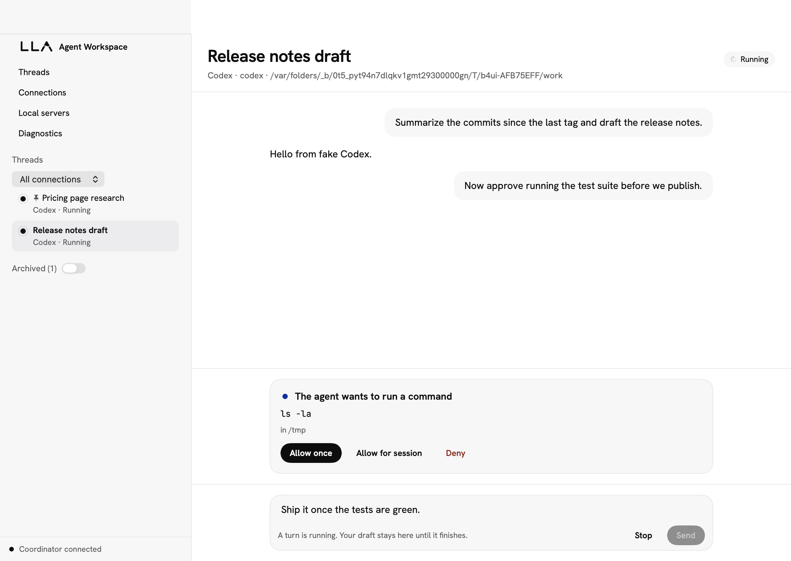

# b4app: Personal Agent Workspace

A native Swift app for running Codex, Claude Code, and B4 agent conversations side by side on one Mac, with an iOS companion built from the same code. Everything is local by default: no accounts, no telemetry, and nothing leaves the Mac unless you run a hub and join it (see "Hub (optional)").

The interface follows the LiveLoveApp visual system (`docs/superpowers/specs/2026-10-31-lla-visual-system-design.md`): ink on white, one cobalt accent, Hanken Grotesk and JetBrains Mono, hairlines and pills, with a derived dark appearance.



Status: M6 (packaging). Codex and B4 conversations are live-verified from the CLI (Codex also from the macOS app); Claude Code conversations use the same transcript, approvals, stop, and resume through the CLI's stream-json protocol and are fixture-verified end to end, awaiting a signed-in Mac for the live inference check. B4 attaches a running local server or a remote HTTPS endpoint at one `agent()` route, or registers a local project and runs its server itself (`b4 start` or `b4 dev` on loopback) with the GUI and the CLI sharing one owned registration. Threads can be renamed, pinned, archived, and searched, keep their drafts across restarts, show their state in the sidebar, and say plainly when a native session is gone or belongs to another account; unknown outcomes stay unknown until a runtime answers or you abandon the turn; two harness turns never write one directory at once; Quit asks before stopping local work; wake and reconnect reconcile instead of guessing. See `docs/milestones.md`.

## Prerequisites

- macOS 26 on Apple Silicon with Xcode 26.6 (Swift 6.3)
- XcodeGen for the app projects: `brew install xcodegen`

## Build and test

The store is a private PostgreSQL cluster (decision D-041). Fetch the pinned server once; tests boot an ephemeral cluster from it:

```bash
./Scripts/fetch-postgres.sh
```

```bash
swift build
```

```bash
swift test
```

Render every screen of the app offscreen (both appearances) into PNGs, over a real coordinator and the fixture runtimes:

```bash
B4APP_SNAPSHOT_DIR=docs/screenshots swift test --filter SnapshotTests
```

```bash
./Scripts/generate-project.sh
```

Then open `B4App.xcodeproj` and run the `B4App-macOS` or `B4App-iOS` scheme, or build from the command line:

```bash
xcodebuild build -project B4App.xcodeproj -scheme B4App-macOS -destination 'platform=macOS'
```

```bash
xcodebuild build -project B4App.xcodeproj -scheme B4App-iOS -destination 'generic/platform=iOS Simulator'
```

## Install (packaged app)

```bash
./Scripts/package.sh
```

That builds `dist/Agent Workspace.app` (version from `Sources/Coordinator/Version.swift`) with the CLI and the coordinator (`B4AppCoordinator.app`, a background-only bundle that can hold its own provisioning profile) inside `Contents/Helpers`, the PostgreSQL server under `Contents/SharedSupport`, signs it (ad hoc unless `B4APP_SIGN_IDENTITY` is set, below), verifies, and zips it. Copy the app to `/Applications` and open it. On first launch the app writes `~/Library/LaunchAgents/com.cacheplane.b4app.coordinator.plist`, pointing at the coordinator inside the app, and loads it; macOS may show "Agent Workspace added items that can run in the background". The coordinator then outlives the window. If launchd cannot start it, the link status at the bottom of the sidebar says so and the window hosts the coordinator itself until the next launch repairs the agent.

Put the CLI on your PATH as a link to the bundled one, so the app and the CLI always agree on a version:

```bash
./Scripts/install-cli.sh
```

Signing (D-039): with no identity the build is ad hoc and runs on the Mac that built it. With a Developer ID Application certificate in the login keychain and a notarytool profile you created yourself (`xcrun notarytool store-credentials b4app --apple-id <apple-id> --team-id <team-id>`, with an app-specific password from account.apple.com; the script never sees it), run

```bash
B4APP_SIGN_IDENTITY="Developer ID Application: <name> (<team-id>)" ./Scripts/package.sh
```

It signs every PostgreSQL binary and library, the CLI, the coordinator bundle, and the app with the hardened runtime and a secure timestamp, verifies, submits the zip to the notary service and waits, staples the ticket to the app, re-zips the stapled app, and fails unless `spctl -a -vv` reports `source=Notarized Developer ID`. A rejected submission prints notarytool's log. `B4APP_NOTARY_PROFILE` names another profile; `B4APP_SKIP_NOTARIZE=1` signs without submitting. The team id comes from the certificate, so the repository stores none (`Config/Signing.xcconfig` includes a gitignored `Config/Signing.local.xcconfig` for Xcode).

A Developer ID build also keeps secrets in the data-protection keychain, shared by the app and the coordinator (D-051). That needs two provisioning profiles, made once at developer.apple.com:

1. Identifiers: register the macOS App IDs `com.cacheplane.b4app` and `com.cacheplane.b4app.coordinator`, each with **Keychain Sharing**.
2. Profiles: create a **Developer ID** profile for each with your Developer ID Application certificate, and save them as `~/.b4app/signing/app.provisionprofile` and `~/.b4app/signing/coordinator.provisionprofile` (or point `B4APP_APP_PROFILE` and `B4APP_COORDINATOR_PROFILE` at them).

The script checks each profile's App ID, team, keychain group, and expiry, embeds it, and signs both with the group `<team-id>.com.cacheplane.b4app.shared`. `agent-workspace doctor` shows which keychain the coordinator uses. Existing items move out of the login keychain the first time they are read, and macOS may ask once per item. A profile lasts 18 years, but the app stops launching once it expires, so regenerate both profiles when the certificate is renewed. `B4APP_SKIP_PROFILES=1` signs without profiles and keeps the login keychain.

### TestFlight (iOS)

The Mac app is not eligible for TestFlight or the Mac App Store: both require App Sandbox, which cannot run your own CLIs, the bundled PostgreSQL, or the LaunchAgent (D-051). The iOS companion ships through TestFlight with Xcode's cloud-managed signing:

1. App Store Connect → Users and Access → Integrations → App Store Connect API: create a **Team** key with the **Admin** role, and save the `.p8` file as `~/.appstoreconnect/private_keys/AuthKey_<key-id>.p8` (it downloads once; never commit it).
2. App Store Connect → Apps → New App: iOS, bundle id `com.cacheplane.b4app.ios`.
3. Run:

```bash
B4APP_ASC_KEY_ID=<key-id> B4APP_ASC_ISSUER_ID=<issuer-id> ./Scripts/upload-ios.sh
```

It archives Release with the team from the Developer ID certificate (or `B4APP_TEAM_ID`) and a build number from the UTC time (or `B4APP_BUILD_NUMBER`). It checks that the archive has a privacy manifest and no localhost ATS exception, then uploads with method `app-store-connect`. Builds are for internal testers unless `B4APP_TESTFLIGHT_EXTERNAL=1`, which needs Beta App Review and a reachable hub; `B4APP_UPLOAD=0` exports the `.ipa` to `dist/ios` instead of uploading. A phone needs a hub it can reach over HTTPS: `localhost` on a device is the phone itself.

### First sign-in

- Codex: install the Codex CLI (`brew install --cask codex`), then under Connections add a Codex connection and press "Sign in with ChatGPT"; the official browser flow runs and the connection shows the account it is signed in as. Or from a terminal: `agent-workspace connection add --kind codex` and `agent-workspace connection login codex`.
- Claude Code: install the `claude` executable, then add a Claude connection and press "Sign in to Claude" (or run `claude auth login` in a terminal). Plan allowances apply; the app never switches to API-key billing on its own.
- Nothing is typed into this app: both runtimes keep their own credentials.

### B4 environment setup

- A local project: under Local servers, register the project directory (the B4 app root with `b4.config` and `node_modules/@b4run/cli`), optionally its env file, and start it; connect one of its discovered routes to get a connection you can start threads on. Registration runs the project's config and route modules with Node to discover routes, so register only projects you trust. Node is found on PATH, in nvm/fnm/Volta/Bun/Homebrew layouts, or via `B4APP_NODE_PATH`.
- An already running local server: Connections › B4 agent, base URL `http://127.0.0.1:<port>` and the route key.
- A remote endpoint: HTTPS only; store the credential with `agent-workspace credential add <label>` and paste the printed reference into the form. Values never appear in arguments, logs, or results.

### The store

Each Mac keeps its workspace in a private PostgreSQL cluster under `~/Library/Application Support/b4app/pg`, reachable only through a Unix socket in the runtime directory; the app's bundle carries the server under `Contents/SharedSupport/postgres`. The coordinator starts the cluster when it starts and stops it when it stops cleanly; a cluster left running is adopted next time when it runs this install's `postgres`, and restarted with it otherwise (after an app update). A `workspace.sqlite` from an earlier version is imported on the first start and renamed `.imported`.

```bash
agent-workspace db status
```

```bash
agent-workspace db backup
```

`db backup` writes every table to a JSON-lines archive under the data directory's `backups`; `db restore <archive>` loads one into an empty store, or over the current one with `--replace`; `db import-sqlite <file>` imports an old store by hand. The coordinator is the only process that opens the cluster; the CLI goes through it.

### Upgrade

Replace the app in `/Applications`. The running coordinator keeps the old version until it is restarted; the sidebar shows "The running coordinator is X; this app is Y" with a Restart coordinator link, the Coordinator menu has the same, and so does `agent-workspace coordinator restart`.

Launching the new app once refreshes the agent when the app has moved; `agent-workspace coordinator status` shows launchd's view of the job and `coordinator restart` starts the new coordinator in place of the old one.

### Uninstall

Coordinator menu › "Remove Background Agent…" (boots the agent out and deletes its plist from `~/Library/LaunchAgents`), quit, then delete the app, `~/Library/Application Support/b4app` (the database and logs), the `agent-workspace` symlink, and the Keychain items whose service starts with `com.cacheplane.b4app`. Registered B4 projects are not touched.

## CLI

```bash
.build/debug/agent-workspace doctor --json
```

```bash
agent-workspace coordinator status
```

`coordinator status|stop|restart` inspect and control the one coordinator process; `restart` goes through launchd when the app's agent hosts it.

A conversation from the terminal (Codex CLI 0.166.0 or newer signed in with `codex login`, or Claude Code 2.1.200 or newer signed in with `claude auth login`; use `--kind claude` and `--connection claude` for Claude):

```bash
.build/debug/agent-workspace connection add --kind codex
```

```bash
.build/debug/agent-workspace thread new --connection codex --cwd ~/project --title "Fix the tests"
```

```bash
.build/debug/agent-workspace turn send <thread-id> Run the test suite and summarize the failures.
```

`turn send` streams the reply, prints tool cards and any runtime request with the `request respond` command that answers it, and exits 0 when the turn completes, 1 when it fails, 130 when it was stopped. Flags may go before or after the message text; a message that starts with a dash goes after `--`. `turn interrupt <thread-id>` stops the active turn; `thread show <thread-id>` prints the cached transcript and `thread show --reconcile <thread-id>` first asks the runtime about an unresolved turn, merges native history into the cache, and reports whether the thread can still be continued; `turn abandon <thread-id>` gives up on a turn whose outcome the runtime never reported (nothing is re-sent); `thread update <thread-id> --title T | --pin | --unpin | --archive | --unarchive` organizes threads locally; every command takes `--json`.

A B4 agent route on a server you already run (`b4 dev` in the project; remote endpoints must be HTTPS):

```bash
.build/debug/agent-workspace credential add research-endpoint
```

```bash
.build/debug/agent-workspace connection add --kind b4 --url http://127.0.0.1:3001 --route /chat#agent --auth-ref secret:<id>
```

```bash
.build/debug/agent-workspace thread new --connection b4 --title "Research"
```

`credential add` reads the secret with a hidden prompt (or one line from a piped stdin), stores it in the coordinator's credential store, and prints a `secret:` reference; `--auth-ref` is optional for servers without middleware. The connection check confirms the server is reachable, not that its model credentials or your endpoint secret work; those are verified on the first turn. B4 threads bind to the route, so `thread new` takes no `--cwd`.

A local B4 project the app runs for you (registering it runs its `b4.config` and route modules with Node, so register only projects you trust):

```bash
.build/debug/agent-workspace server add ~/code/my-agent --name research --env-file ~/code/my-agent/.env
```

```bash
.build/debug/agent-workspace server start research
```

```bash
.build/debug/agent-workspace connection add --kind b4 --server research --route /chat#agent
```

`server add` resolves Node 24+ and the project-installed `@b4run/cli` (never `.bin/b4`, never downloaded), allocates a loopback port once, and inspects the routes with `b4 routes --json`. `server start` runs `b4 start --host 127.0.0.1 --port <n>` (source mode, the default) or `b4 dev --port <n> --env-file <p>` (`--mode development`, hot reload) from the project directory with an environment the coordinator builds from the env file, waits for `/healthz`, and is idempotent. `server status`, `server logs [--follow]`, `server restart`, `server stop`, `server inspect`, and `server list` work the same from the Local servers screen; `stop` and `restart` refuse while a route connection has a running turn unless `--force`. Servers keep running when the app quits or the coordinator restarts; the next coordinator re-adopts one whose pid, start time, and arguments still match, and never signals anything else. Logs live under the data directory and are redacted when read.

The CLI connects to the running coordinator or starts `b4app-coordinator` next to itself. Set `B4APP_RUNTIME_DIR` and `B4APP_DATA_DIR` to isolate an experiment from the real data under `~/Library/Application Support/b4app`. The runtime directory must be short enough for a Unix socket path (104 bytes); the default under `$TMPDIR` is.

Live provider tests are opt-in and never run in CI:

```bash
B4APP_LIVE_CODEX=1 swift test --filter CodexLive
```

```bash
B4APP_LIVE_CLAUDE=1 swift test --filter ClaudeLive
```

```bash
B4APP_LIVE_B4_URL=http://127.0.0.1:3001 B4APP_LIVE_B4_ROUTE=/chat#agent swift test --filter B4Live
```

The B4 live check needs a server you run yourself: a B4 project with one `agent()` route, started with `b4 dev --port 3001 --env-file .env` where that `.env` holds the model provider key, or the same project registered with `server add` and started by the app. This repo's `.env` is gitignored for exactly that; B4 keeps the provider key, the app never sees it. On the owner's Mac the trusted project is `~/repos/b4app-live-check`.

## Hub (optional)

The hub (`Hub/`, a Rust service backed by PostgreSQL) mirrors conversations created in the app from a Mac to the iOS app (M8a, decisions D-043 to D-046) and, since M8b, carries the phone's own edits back (decisions D-048 to D-050). The phone shows threads and transcripts in the same attention order as the Mac, and can rename, pin, archive, and mark threads read or unread, rename projects, and edit a thread's shared draft; each edit applies on the phone at once, waits in an outbox while offline, and merges on the Mac and the hub column by column by hybrid logical clock. Only those columns are phone-writable, and the hub and the Mac both refuse anything else from a phone. Projects are created and their folders changed only on the Mac; the phone cannot yet create threads, send turns, or answer approvals (M8c). Only threads created in the app sync: nothing is read from `~/.codex`, `~/.claude`, or a B4 server's history, and connection credentials, executable paths, and local-server records never leave the Mac. The hub's wire reference is `Hub/API.md`.

Start a local hub (needs Docker). Compose publishes the hub as `127.0.0.1:8080:8080`: plain HTTP on the Mac's loopback interface only, which the Mac and the Simulator reach as `localhost` (any other device needs a hub behind TLS, since the clients refuse plain HTTP for any host but `localhost`); the database is not published:

```bash
cd Hub && cp .env.example .env
```

Fill in `POSTGRES_PASSWORD` and `B4HUB_APP_PASSWORD` in `.env` (URL-safe printable ASCII, for example `openssl rand -hex 24` each; the file is gitignored), then:

```bash
docker compose build && docker compose up -d && curl -fsS localhost:8080/readyz
```

Create the organisation and user, then mint a one-time enrollment code for each device. `seed` and `enroll` are operator commands that run through the `migrate` service, because only it holds the database owner's URL:

```bash
docker compose run --rm migrate seed --org cacheplane --org-name cacheplane --user blove --name "Your Name" --email you@example.com
```

```bash
docker compose run --rm migrate enroll --user blove
```

The code is eight characters, valid for ten minutes, and works once. Join the Mac (the code is read from a hidden prompt or one line of stdin, never an argument):

```bash
.build/debug/agent-workspace hub join http://localhost:8080
```

Join the phone by entering the same hub URL, a second enrollment code, and a device name on the iOS app's Connect screen. The Mac pushes its history and every later change; the phone's thread list and open transcripts update without a refresh. The clients accept `http` only for `localhost`, `127.0.0.1`, and `::1`; any other hub must be `https`, and both sides refuse anything else before sending a request. The Simulator reaches the hub at `http://localhost:8080`. Simulator builds need code signing for the Keychain (Xcode's default "Sign to Run Locally" works; `CODE_SIGNING_ALLOWED=NO` builds fail with Keychain error -34018 when the app tries to store its device token).

```bash
.build/debug/agent-workspace hub status
```

```bash
.build/debug/agent-workspace hub leave
```

`hub status` shows the hub, this device, the account, and how many changes are still unsynced. `hub leave` revokes this device at the hub and stops pushing; what it already uploaded stays on the hub. While a Mac is joined, `db restore` is refused: leave first, restore, then join again. A restore marks every restored change unsynced, so the next join uploads the restored history. (`hub join`, `hub status`, and the push were exercised live in M8a; `hub leave`, the restore refusal, and history surviving a revoke are fixture-tested only.) On the phone, removing the app is the only way to disconnect for now, and it leaves the device unrevoked at the hub.

## Layout

```
Package.swift            umbrella package: libraries, coordinator, CLI, tests
Sources/WorkspaceProtocol   commands, events, errors, domain (runtime-neutral)
Sources/WorkspaceClient     typed coordinator client (runtime-neutral)
Sources/WorkspaceUI         SwiftUI shared by macOS and iOS
Sources/WorkspacePlatform   paths, executables, processes, lock
Sources/WorkspaceSecrets    secret references and the Keychain store (both platforms)
Sources/WorkspaceSync       hub wire types and HTTP client (Foundation only)
Sources/WorkspaceMirror     the iOS app's SQLite mirror of the synced tables
Sources/WorkspaceStorage    PostgreSQL store, migrations, backup and restore
Sources/Coordinator         event log, router, session service, socket server, launcher, HubSync
Sources/CoordinatorMain     the b4app-coordinator executable
Sources/AgentWorkspaceCLI   the agent-workspace executable
Sources/NIOTransport        Unix socket transport
Sources/CodexAdapter, ClaudeAdapter, B4Adapter
Apps/macOS, Apps/iOS        thin app targets (project.yml, XcodeGen)
Hub/                        the Rust hub: b4hub-core, b4hub-db, b4hub, Dockerfile, Compose
docs/                       spec, design, decisions, compatibility, verification, research
```

## Documents

- Spec: `docs/roadmaps/Personal_Agent_Workspace_Technical_Spec_and_Roadmap.md`
- Design: `docs/superpowers/specs/2026-10-30-swift-monorepo-shell-design.md`, `docs/superpowers/specs/2026-10-30-m1-codex-conversation-design.md`, `docs/superpowers/specs/2026-10-31-m2-claude-conversation-design.md`, `docs/superpowers/specs/2026-10-31-m3-b4-conversation-design.md`
- Decisions: `docs/decisions.md`
- Compatibility: `docs/compatibility.md`
- Verification: `docs/verification.md`
- Research notes: `docs/research/`
