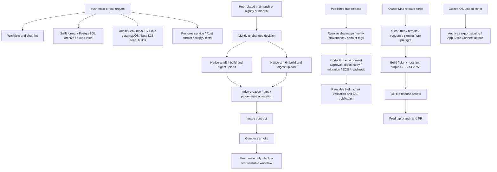

# CI delivery investigation, 2026-11-02

**Verdict: Incomplete.** The instrumentation works within the tested scope. A delivery speedup, final hosted candidate validation, exact executed workflow revisions, and accepted availability remain unverified. No publication, deployment, tagging, protection change, shared-cache mutation, or additional hosted run was performed. No commit was created.

## Change and bounded decision

Candidate Q adds `.github/scripts/ci-observations.py`, its standard-library fixture tests, and one test step in the existing CI lint job. It collects a bounded unfiltered run population using GET-only GitHub API calls, enumerates every attempt and jobs page, and retains job/step timestamps and conclusions. Offline replay produces deterministic JSON. It rejects missing attempts, truncated pages, duplicate jobs/steps, source mismatches, malformed terminal results, and missing step inventories. Existing capture files cannot be overwritten. It is an observation tool, **not a publication or release-acceptance gate**.

One instrumentation iteration was authorized and budgeted in `manifest-v1.json` before implementation. Alternatives were native-job splitting, compiled-cache changes, and observation capture. The first two lack equivalent-workload evidence, so neither was implemented. No unsupported speed optimization was retained. This deliberately leaves the optimization objective unmet rather than asserting a speedup from static edits. The user's autonomous implementation instruction supersedes skill design-approval pauses; no external mutation authority was inferred.

After network sandbox failure, an authorized read-only escalation reached GitHub. The initial `gh auth status` failure was therefore not proof that history was inaccessible. Read-only collection then succeeded. No pending publication approval is needed to review these local changes.

## Delivery graph and acceptance boundaries



The graph is source evidence, not proof that all deployed endpoints are accepted. The hub release path resolves an image produced earlier; its narrower publication trigger excludes build/validation compute. It is a different boundary from fresh construction. `infra.yml` separately plans on PRs and applies test then production with production approval; configured-variable skips and a scaled-to-zero deployment can be green without endpoint acceptance. GHCR cleanup is a separate scheduled/manual mutation path with its own dry-run controls; it was not invoked. Chart PR validation includes kind tests. Refer to the unchanged workflow and helper source for full prerequisites.

The CI branches are independent, but last job completion is not necessarily workflow completion. Its slowest observed branch varies, including cancelled native jobs. No assertion is made that this CI graph is a required cross-workflow prerequisite to every existing release mutation. That policy linkage was not added or certified here.

Mac prod obligations remain a signed/notarized/stapled versioned ZIP, stable-name ZIP, GitHub release and tap PR; beta remains a prerelease ZIP. iOS prod/beta remain separate owner-run upload channels. Hub obligations remain both OCI architectures, digest/provenance checks, deployment readiness and chart publication. Downloads, install/update success and user adoption are separate observations, all unknown in this investigation.

## Evidence and clocks

| ID | Mode | Identity and collection | Limitation |
| --- | --- | --- | --- |
| S01 | S | `manifest-v1.json`, `plan.md`; source `02f201c0e504004df512d88e267ca6d82af8410d` | Scope/design and adopted gates, not runtime success |
| S02 | S | Existing workflows, package/release/upload scripts, deployment/image/Compose/chart helpers; candidate file hashes | Static dependency and preservation evidence |
| R01 | R | `selection.json`, `evidence.json`, `evidence-final.json`; run/attempt/source identities embedded | API metadata, no logs, runner-image versions, artifact manifests or endpoints |
| B01 | B | `validation.json`, collector tests; fixture mode explicitly simulated | Local behavior, not hosted integration or publication |
| R02 | R | `validation.json`, `validation.log` | Actual local commands and exit codes; no native candidate build |
| A01 | A | `candidate-files.sha256`, `evidence-files.sha256` | Local evidence/configuration identity only; release artifact lineage unknown |
| M01 | M | `validation.json`; collection start/end timestamps and derived API job intervals | Local wall times and completed job intervals; no CPU/billing/dollar measurement |

`selection.json` preserves the initial eight most recent CI runs, without outcome filtering, from the API's 178-run population. They span creation times 19:48:15–21:04:11 UTC on November 2. This is a small diagnostic sample, not a representative reliability or tail-latency study. Selected runs remain fixed across both captures; source revisions differ from each other and from the local product baseline. No run is excluded. There are **eight CI request/run IDs, nine attempts, and zero identified release intents**.

The first capture spans 21:06:33–21:06:46 UTC; final capture 21:11:11–21:11:21 UTC. These captures are not atomic snapshots: status and jobs can advance between GETs. The collector retains those statuses rather than reconciling them into invented completion. A run listed as queued may already have completed jobs. A new attempt after the frozen selection belongs in a new selection/capture, not silently in this population. The first evidence packet received an explicitly documented metadata augmentation during review: selection total/limit from the frozen response and the calculated 18-read count. No run/job/step timestamps or conclusions were corrected.

The report exposes API attempt `created_at`, original attempt-1 `run_created_at`, `run_started_at`, and job/step starts/ends. It derives attempt-creation-to-last-current-job-end, original-run-creation-to-last-current-job-end, and attempt-start-to-last-current-job-end. It does **not** use `updated_at` as completion or a commit-author timestamp as trigger. Missing job starts/ends leave the span unknown. Job duration sums differ from wall span; unidentified eligibility, approval, allocation and dependency intervals remain unexplained waiting.

For rerun `41519926572`, original creation is 20:31:10 UTC; attempt 2's API creation is 20:50:35 UTC. Last observed fresh job end is 20:58:33 UTC: **1,643 s from original creation**, **478 s from attempt creation**, and **479 s from attempt start**. None is accepted availability. Its attempt-2 response includes cloned earlier jobs with new IDs but old timestamps. Intervals ending before attempt start are separated as `predates_attempt`; this is a timestamp-based inference, not provenance certification.

Trigger, actionable developer feedback, final workflow completion, publication, accepted availability, approval-excluded timing, source-change-to-availability, recovery-inclusive release completion, cache state, exact pipeline revision, artifacts/digests and dollars remain unknown (`null` or explicit unknown). No release-intent grouping is inferred from similar labels. Partial rerun success does not certify that carried checks cover the current contract.

## Observations, hypotheses and decision

`attempts.jsonl` is the compact machine-readable ledger for the final capture, with evidence pointers; `evidence*.json` retain jobs/steps and source identities. They are executable with the report command below. The captures show evolving state, **not baseline versus optimized latency samples**.

The initial API intervals total 10,083 completed current-attempt macOS seconds and 1,773 Ubuntu seconds. Ongoing job intervals are excluded from those sums and remain unknown. Another 897 macOS and 222 Ubuntu seconds appear carried in the rerun response and are not counted again. These are observed intervals, not billed compute, and the incomplete sample understates eventual total execution. Cancelled/failed work is retained.

Measured diagnostic lead: completed package jobs show Swift Test intervals of **738 s (success), 751 s, 717 s, and 745 s (failures)**; corresponding Build steps are 93 s, 106 s, 79 s and 103 s. This ranks test diagnosis above optimizing setup/cache transfer in this sample. Root cause and equivalent required coverage are unresolved; deleting tests, filtering them or adding workers would not be justified by this evidence. Native app jobs and unexplained waiting also matter. No percentile, dependable reliability estimate or speed/cost improvement is reported.

The baseline repository had no checked-in reproducible attempt-ledger collector. Candidate Q can replay the same observed population into nine attributed attempt records, reject incomplete evidence and distinguish fresh/carried intervals. That is a demonstrated measurement capability, not a demonstrated delivery speedup. `findings.json` records candidate defects exposed and fixed by negative experiments and independent review, plus the baseline test failures left unresolved. No competing optimization experiment was silently discarded.

Three independent read-only first passes covered dependency/performance, integrity/recovery and measurement/tests. They received the same manifest/source/evidence packet before receiving each other's findings. Reviewer findings were consolidated by underlying cause rather than counted repeatedly. Request budget, retry-clock ambiguity, truncated selection, missing steps, malformed terminal results, identity mismatch and missing-start span issues were resolved through regression tests. Final scoped retests reported no remaining findings. Agreement is not a probability of correctness. The last one-line reporting correction leaves exact pipeline revision null; raw source head SHA remains available.

## Gates, remaining work and rollback

`criteria.csv` assigns exactly one status to every C01.1–C15.3 atomic check in a named case, with authority/gate designation explained by the manifest and case reason. `coverage.json` calculates required-only coverage; advisory and Not applicable counts are separate. Required-only G = 20: 18 Pass, 0 Fail, 2 Untested; assessed and verified-pass coverage are both 90%. Advisory results are 3 Pass, 17 Untested and 5 Not applicable. These are observation-scope assessment numbers, not a release score. Existing mandatory product/release obligations are not waived by advisory treatment of unchanged mechanisms: their actual acceptance remains open. Exact executed pipeline identity and final hosted/native/cold/integrated acceptance are required Untested rows, so the result is **Incomplete**, regardless of the local pass rate.

The reserved holdout is a failed first attempt followed by a partial rerun with skipped native work. It retains the failure and unknown timing/availability. Fixture pagination exceeds 100 jobs; invalid/missing/duplicate inputs and API failure cannot produce a complete report. CLI replay and refusal to replace existing captures are exercised. The final code's live GET collector also recaptured the same eight-run population. Tests execute again after the last relevant change; results are in `validation.json`.

Budget: at most one substantive instrumentation iteration, 100 GETs per collection, 60 s per GET, no automatic retries, zero new hosted runs/services and a 300 s local validation-command budget. The two collections used 18 GETs each; two successful discovery requests preceded them. A sandbox connection failure is recorded separately. There is no overall collection wall deadline; a failed request can wait up to 60 s, and output is not written on failure. Actual dollar cost, existing runner billing and transfer/storage accounting are unknown. Incremental CI time for the new test step is unmeasured on Ubuntu; local runtime is in `validation.json`. No new dependency, cache namespace or paid service is introduced.

Reversal: remove only `.github/scripts/ci-observations.py`, `.github/scripts/tests/test_ci_observations.py`, the two-line observation-test step in `ci.yml`, and the documented delivery additions if unwanted. Restore those paths from the pre-change revision after reviewing unrelated edits. There is no production state to recover. Existing-capture preservation is tested; no production rollback was exercised.

To continue, capture a fresh, prespecified sample with compatible sources/pipelines, logs, runner images, cache states and native outputs. Diagnose the long/failing Test steps before choosing one optimization. Use interleaved equivalent warm/cold executions, retain ongoing/retry outcomes, then apply the frozen provisional 10% median latency / 5% runner-second / 10% cold-regression limits. Link actual artifacts, approved release intents and endpoints before calculating accepted availability. Running an existing hub-image push/manual workflow is not an isolated benchmark: it can publish image tags, and main push can deploy to test. Any such external mutation needs applicable authority first.

## Reproduce safely

From the repository root, offline:

```sh
python3 -m unittest discover -s .github/scripts/tests -v
python3 .github/scripts/ci-observations.py report docs/delivery/2026-11-02/evidence.json
python3 .github/scripts/ci-observations.py report docs/delivery/2026-11-02/evidence-final.json
```

Read-only remote collection to a **new** local path (requires `gh` read access):

```sh
python3 .github/scripts/ci-observations.py collect \
  --repo cacheplane/b4app --workflow ci.yml --limit 8 \
  --output /tmp/b4-ci-new-capture.json
```

Use `--selection docs/delivery/2026-11-02/selection.json` to preserve this investigation's population. It intentionally bounds attempts to the selection snapshot. Capture files contain operational source/run IDs and job names; they exclude actor/title/commit-message/log bodies. Review access before sharing future captures. API semantics were checked against [workflow runs](https://docs.github.com/en/rest/actions/workflow-runs) and [workflow jobs](https://docs.github.com/en/rest/actions/workflow-jobs); these API fields alone do not establish distribution readiness.
