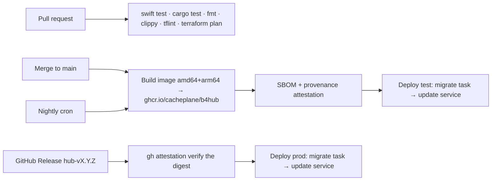

# The hosted hub: deployment architecture

Date: 2026-11-02. Owner: Brian Love. Status: approved by the owner 2026-11-02 (D-068 to D-072).

This document is the architecture for running the b4 hub (`Hub/`) as a hosted service at `hub.b4.run` and `hub.test.b4.run`, and for shipping the same image to customers who run it themselves with Docker Compose or Helm. It replaces the generalized reference-platform notes that first occupied this file (summarised in the appendix). It builds on `docs/superpowers/specs/2026-10-31-m8-hub-design.md` (the hub, tenancy, one image for cloud and on-prem), `2026-11-01-m8c-relay-design.md` (D-054 to D-059, the relay and its one-replica constraint), and the sign-in design (`2026-11-01-sign-in-design.md`, D-061 to D-067, whose section "The hosted hubs (a separate project)" is the contract between that project and this one). Research: `docs/research/reports/Managed hosting for the b4 hub.md`, cited below as "the research"; every price and vendor limit in this document comes from it and carries its date (2026-11-01).

Like the document it replaces, this one separates what is **designed** from what has been **verified live**. Nothing below is deployed yet. `docs/verification.md` records each gate as it is passed.

## Intent

A person downloads the Mac app from b4.run or installs the iPhone app from the App Store, signs in with an Apple ID or a passkey, and their threads sync between their devices through a hub that cacheplane runs. A tester does the same against a separate test hub from TestFlight. A company that will not send its data to cacheplane runs the identical image on its own machines. The owner wants to operate none of this by hand: the infrastructure is code, a merge deploys the test hub, a release deploys production, and the whole thing is cheap while the audience is one person and grows into a multi-region, fail-safe service without being rebuilt.

The owner's direction, in his words where it matters:

- Hosting: "paying a managed host to run the container and the database" rather than operating Kubernetes; "I suspect that will be higher cost, but we can likely fix that then." Then, after the research: "I think we need to do AWS from day one."
- Release flow: "main is latest, we build nightly artifacts using main, production is a release. code reaches test hub on merge to main. code reaches prod hub on release."
- Failure tolerance now: "At this stage, I think most of it would be a ¯\\_(ツ)_/¯. However, we want to build towards a robust solution that is multi-region and fail safe."
- Providers: "DNS is currently in Vercel. We do not have AWS, but we can use it. I do not want to use GCP or cloudflare."
- Infrastructure as code: "Terraform".
- Scope: the on-prem Compose and Helm packaging and PR previews are in this document "even if they come later, I want the docs".

## Goals

1. `https://hub.b4.run` and `https://hub.test.b4.run` serve the `Hub/` image with its migrations applied, over HTTPS, carrying M8c's WebSockets, 25 s long-polls, and Apple's browser form POST, with every environment variable the sign-in design names.
2. A merge to `main` deploys the test hub and a GitHub Release tagged `hub-v<version>` deploys production, with no step done by hand after the first bootstrap. Nightly images are built from `main`.
3. Everything in AWS is Terraform in this repository, applied by GitHub Actions through OIDC, with no long-lived cloud credentials anywhere.
4. The "now" tier costs on the order of $100 a month for both environments, and every later tier (two instances, in-region HA, a second region) is an addition to it, never a migration off it.
5. The same image, unchanged, ships as a Compose stack and a Helm chart for self-hosting, with the migrate/serve privilege split preserved.
6. A one-person operator is told when the hub is down, can restore a backup, and can roll back a deploy, each by a written runbook.

## Non-goals

- Running agents anywhere but the user's Mac. The hub stores and relays; it never calls Codex, Claude, or B4.
- Hosting the b4.run website, `test.b4.run`, or `local.b4.run`. Those stay on the b4run Vercel project (sign-in design, "The website"), including the apple-app-site-association files and `/pair`. Only the `hub.*` names are this project's.
- Operating Kubernetes for the hosted hubs. The Helm chart is for customers.
- Automatic cross-region database failover. The "later" tier is a drilled, human-initiated promotion (see "Availability").
- Multi-writer PostgreSQL. The hub's per-organisation `hub_seq` is a dense, ordered cursor; global-sequence schemes break it.

## Anti-goals

- A second code path for the cloud. No AWS SDK in the hub binary, no cloud-specific secret loading, no feature the on-prem image lacks. The hosted hub differs from an on-prem hub only in its environment variables.
- A secret value (database password, Apple private key, `B4HUB_SECRET_KEY`, device token) in Terraform state that is readable by a human role, in a GitHub Actions log, in a task definition's plain `environment`, in CloudWatch Logs, or in a committed file.
- Terraform applied from a laptop after bootstrap. Drift between code and account is a failure even if the account works.
- A test-environment mistake that can reach production data. The environments are separate AWS accounts, not separate prefixes.
- Mistaking the host's load balancer for a security control the application does not also enforce. Rate limits and body limits live in the hub and the edge only adds to them.

## Constraints

- The repository rules hold. `Hub/` stays a Cargo workspace producing one image whose `ENTRYPOINT` is the binary and whose commands are `migrate`, `serve`, `seed`, and `enroll` (D-043). Secrets never appear in arguments, results, or logs.
- D-057: the relay's routing state is in process memory, so each environment runs exactly one hub instance until M8e adds cross-instance routing. The sign-in design confirms that ceremonies and handoffs live in PostgreSQL, so sign-in itself is already replica-safe; only the relay and the in-memory per-IP rate limits are per process.
- The hub drains for `B4HUB_SHUTDOWN_WAIT_MS` (30 s) after SIGTERM, failing `/readyz` first; anything that stops it must wait at least 35 s.
- `B4HUB_TRUST_X_FORWARDED_FOR=1` makes the hub take the client IP from the right-most `X-Forwarded-For` entry. On an AWS Application Load Balancer in its default `append` mode the right-most entry is the client, so this setting is correct as the sign-in design specified it. (The research found it is wrong on Fly, Render, and DigitalOcean, which is one reason the on-prem docs tell operators to configure their proxy to append.)
- DNS for `b4.run` stays at Vercel. Everything AWS needs from DNS is a CNAME record, and the hub never depends on Route 53 for the apex.
- No Google Cloud, no Cloudflare, anywhere in the path.

## The shape of the system

```
                 Vercel DNS (b4.run zone)
       hub.b4.run CNAME ──────────────┐        hub.test.b4.run CNAME ───────────┐
                                      ▼                                          ▼
   ┌──────────── AWS account: b4hub-prod (us-east-2) ────────────┐  ┌── AWS account: b4hub-test ──┐
   │  ALB (HTTPS, ACM cert, idle 120 s)                           │  │  the same module, smaller   │
   │     └─► ECS Fargate service "hub", 1 task, arm64             │  │  RDS single-AZ, 1 task,     │
   │            b4hub serve  ◄── Secrets Manager (env injection)  │  │  7-day backups              │
   │            │                                                 │  └─────────────────────────────┘
   │            ▼                                                 │
   │  RDS PostgreSQL 17 (private subnets, 7-day PITR, gp3)        │   GitHub Actions (OIDC, no keys)
   │  ECS one-off task "hub-migrate" (privileged URL only here)   │     ├─ build → ghcr.io/cacheplane/b4hub
   │  ECR pull-through cache ◄── ghcr.io                          │     ├─ terraform plan/apply per env
   │  CloudWatch Logs + alarms → SNS → owner                      │     ├─ main → test: migrate task, update service
   └──────────────────────────────────────────────────────────────┘     └─ hub-v* release → prod: the same
                        ▲ outbound HTTPS only to appleid.apple.com
   Mac coordinator, iPhone, CLI ──HTTPS/WSS──┘            Better Stack / UptimeRobot probes /readyz from outside
```

Three AWS accounts under one AWS Organization: a management account that holds only the Organization, billing, and the IAM Identity Center users, and two member accounts, `b4hub-prod` and `b4hub-test`, each holding one complete copy of the stack. The accounts are the blast-radius boundary the anti-goals ask for, and they cost nothing. (My call; the research compared only single-account layouts. An account per environment is the AWS-recommended baseline and the one thing that is painful to retrofit.)

One region to start, `us-east-2` (Ohio). My call: it is a full-service region with Graviton Fargate and every RDS feature, it is a few milliseconds from the owner, and it is not `us-east-1`, which carries the control-plane dependencies of the rest of AWS and had the largest outage of 2025. The second region, when it comes, is `us-west-2`.

## Infrastructure as code

Terraform, in this repository under `Infra/`, applied by GitHub Actions. Layout (my call, following the module-per-stack convention the reference platform used without its split into networking, cluster, and DNS stacks, which a single-service system does not need):

```
Infra/
  bootstrap/            one-time, per account, applied by hand once: state bucket, OIDC provider, deploy roles
  modules/hub/          the whole environment: network, alb, ecs, rds, secrets, observability
  envs/test/            main.tf = module "hub" with test sizes; backend config for the test account
  envs/prod/            the same with production sizes
  README.md             bootstrap steps, how to run plan locally read-only, the runbooks
```

- **State.** One S3 bucket per account (`b4hub-<env>-tfstate`, versioned, SSE-KMS, public access blocked), with Terraform's native S3 lockfile (`use_lockfile = true`, Terraform 1.10 or newer), so there is no DynamoDB lock table. State is sensitive (it holds resource ids and, for some resources, generated values), so only the deploy role and the owner's Identity Center role can read it.
- **Providers and versions** pinned in `Infra/.terraform.lock.hcl`; the Terraform version pinned in `Infra/.terraform-version` and the workflow. OpenTofu is not used; nothing in the design depends on a feature OpenTofu lacks, so a later switch is possible.
- **Workflow.** `infra.yml`: on a pull request that touches `Infra/`, `terraform fmt -check`, `validate`, `tflint`, and `plan` for both environments, with the plan posted as a PR comment. On merge to `main`, `apply` for test automatically, then `apply` for prod in the `production` GitHub Environment, which requires the owner's approval. Infrastructure changes therefore reach production on merge with a human gate, independently of application releases. (My call: tying infrastructure to `hub-v*` releases would leave a merged-but-unapplied window in which `plan` on the next PR shows someone else's changes.)
- **Bootstrap** is the one hand-run step per account and is documented as a numbered runbook in `Infra/README.md`: create the account in the Organization, sign in through Identity Center, run `terraform apply` in `Infra/bootstrap` with local state, then move that state into the bucket it just created. Bootstrap creates the GitHub OIDC identity provider and two roles: `b4hub-<env>-plan` (read-only, assumable from any PR of `cacheplane/b4app`) and `b4hub-<env>-deploy` (assumable only from the `main` branch for test and from the `production` Environment for prod, using the `environment:` subject claim).
- **Three roles per account**, created by bootstrap and assumable only from GitHub's OIDC provider with subject conditions: `b4hub-<env>-plan` (the AWS `ReadOnlyAccess` policy plus state-bucket read; any PR of `cacheplane/b4app`), `b4hub-<env>-infra` (`AdministratorAccess` under a permissions boundary that denies IAM user and access-key creation and Organization changes; the `main` branch for test, the `production` Environment for prod; this is what `terraform apply` runs as), and `b4hub-<env>-deploy` (scoped to the application deploy: register the two task definitions, `ecs:RunTask` and `ecs:UpdateService` on the known service and tasks, `iam:PassRole` for the task roles, push to the ECR repository, read the deploy log group). The infra role is broad because Terraform creates VPCs, RDS, KMS keys, IAM roles, and WAF; the deploy role is narrow because it runs on every merge.
- **No secrets in code or state.** Terraform creates the Secrets Manager secrets as empty shells and ignores their values (`lifecycle { ignore_changes = [secret_string] }`); the owner sets the values once with the AWS CLI from a terminal (`aws secretsmanager put-secret-value --secret-string file://...`), never through Terraform and never through GitHub. The RDS master password is generated and rotated by RDS (`manage_master_user_password = true`) and is used exactly once, at bootstrap, to create the hub's owner role (see "Data"); nothing else ever reads it.

## Network

Per account, one VPC with two availability zones (a third when the second instance arrives):

- Public subnets hold the Application Load Balancer and, at the "now" tier, the Fargate tasks with public IPs. Private subnets hold RDS, which has no public endpoint.
- **No NAT gateway at the "now" tier** (my call). The hub needs outbound HTTPS only to `appleid.apple.com`, and it needs to reach ECR, Secrets Manager, and CloudWatch Logs. A NAT gateway costs about $32 a month plus data; a task public IP costs about $3.65. The task's security group allows inbound only from the load balancer's security group on port 8080, and outbound only on 443 and to the RDS security group on 5432, so a public IP exposes nothing the load balancer does not already expose. The "next" tier moves tasks to private subnets behind a NAT gateway when a second task and a stable egress address become worth paying for; the Terraform module takes a boolean for this so the move is a plan, not a redesign.
- Gateway VPC endpoints for S3 (free) so ECR layer pulls stay off the public path; interface endpoints for ECR, Secrets Manager, and Logs are deferred to the private-subnet step (they cost about $7 each a month).
- Security groups, not network ACLs, carry the policy: ALB accepts 443 from anywhere and 80 only to redirect; tasks accept 8080 from the ALB; RDS accepts 5432 from the task security group and from the migration task's security group.

## Compute

**ECS on Fargate, one service per environment, one task.** Task size 0.25 vCPU and 0.5 GB on arm64 (Graviton; the image is already built for linux/arm64 and the Graviton rate is about 20 percent lower). The task definition:

- `image`: the digest, never a tag (see "Build and release").
- `command`: `["serve"]`; the image's `ENTRYPOINT` is the binary.
- `stopTimeout: 60` (ECS allows up to 120 s), so SIGTERM is followed by at least the hub's 30 s drain plus headroom.
- `environment`: `B4HUB_PORT=8080`, `B4HUB_PUBLIC_URL`, `B4HUB_SIGNUP=open`, `B4HUB_WEBAUTHN_RP_ID` (`b4.run` or `test.b4.run`), `B4HUB_APPLE_AUDIENCES`, `B4HUB_TRUST_X_FORWARDED_FOR=1`, `B4HUB_RETENTION_DAYS`, `B4HUB_LOG=info`. Nothing secret.
- `secrets`: `DATABASE_URL`, `B4HUB_SECRET_KEY`, `B4HUB_APPLE_TEAM_ID`, `B4HUB_APPLE_KEY_ID`, `B4HUB_APPLE_PRIVATE_KEY`, each a `valueFrom` reference to a Secrets Manager secret, injected by the ECS agent as environment variables at task start. Secrets Manager holds multi-line values verbatim, so the PEM arrives intact. `B4HUB_APPLE_BASE_URL` is never set on a hosted hub.
- Health: the load balancer's target group checks `GET /readyz` every 10 s, healthy after 2, unhealthy after 3; the container `HEALTHCHECK` in the image is kept for Compose and ignored by ECS.
- Logging: the `awslogs` driver to a log group per environment with 30-day retention (90 for prod, my call; longer retention moves to the observability vendor).
- Task role: nothing (the hub calls no AWS API). Execution role: pull from the ECR cache, read the five secrets, write the log group.

**Deployment strategy while there is one task.** `deployment_minimum_healthy_percent = 0`, `deployment_maximum_percent = 100`: ECS stops the old task, waits for it to drain, and starts the new one. This is a deliberate outage of about 45 to 90 s per deploy (drain, image pull, start, two health checks), chosen over the alternative of two tasks briefly serving at once, because D-057 says two hubs cannot both route relay commands and a phone would otherwise see "device offline" for a Mac connected to the other task. Clients already reconnect with backoff and resume from their cursor (D-054), so a deploy costs latency, not data. The deployment circuit breaker is on with rollback, so a task that never passes `/readyz` is replaced by the previous task definition without intervention. When M8e lands, the percentages become 100/200 and the service becomes two tasks across two zones; nothing else in the module changes.

**The migration task.** A second task definition, `hub-migrate`, same image digest, `command: ["migrate"]`, whose `secrets` are `DATABASE_ADMIN_URL` and `DATABASE_URL` and nothing else, run as a one-off ECS task by the deploy workflow before the service is updated. The serving task definition does not carry `DATABASE_ADMIN_URL`, so the privileged role is unreachable from `serve`, which keeps the split the Compose file already enforces. The migration's exit code gates the deploy: non-zero stops the workflow and the old task definition keeps serving. Migrations are forward-only and must be expand/contract-compatible with the previous release for the duration of the outage window, which is short, so in practice the rule is simply that a release's migration never breaks the release before it.

**Image source.** The canonical registry is GitHub Container Registry, `ghcr.io/cacheplane/b4hub`, public, because on-prem customers pull from it and because the build already attests there. Each AWS account has one ECR repository, `b4hub`, and the deploy workflow copies the release's multi-platform index into it by digest (`docker buildx imagetools create --tag <account>.dkr.ecr.us-east-2.amazonaws.com/b4hub:<digest-tag> ghcr.io/cacheplane/b4hub@sha256:...`, which preserves the index digest) before registering the task definition against the ECR copy. Pulls therefore stay in-region and a GHCR outage cannot stop a task from starting or being replaced. (My call: ECR's pull-through cache for GHCR needs a GitHub personal access token stored in each account, a long-lived credential the goals forbid; a copy made by the OIDC deploy role needs none.) The digest is the same on both sides, so attestation verification against GHCR covers what ECS runs. Any other image the account runs (none at the "now" tier) comes from the ECR Public Gallery, which needs no credential.

## Request routing

1. A client resolves `hub.b4.run`. Vercel's zone answers with a CNAME to the load balancer's DNS name (`b4hub-prod-....us-east-2.elb.amazonaws.com`). `hub.*` are subdomains, so a CNAME is allowed; nothing is at the apex.
2. The Application Load Balancer terminates TLS with an ACM certificate for `hub.b4.run`, validated by a CNAME record the owner adds at Vercel once (ACM renews automatically while the record exists). Security policy `ELBSecurityPolicy-TLS13-1-2-Res-2021-06` or AWS's newer recommended policy at build time: TLS 1.2 minimum, TLS 1.3 preferred. Port 80 answers only a 301 to HTTPS.
3. One listener rule forwards everything to the hub target group. The idle timeout is raised from 60 s to 120 s so a 25 s long-poll and a WebSocket with a 10 s heartbeat both have ample margin; the ALB upgrades WebSockets natively and keeps them for the life of the task.
4. The ALB appends the client address to `X-Forwarded-For`, which is why the hub's right-most rule is correct here; it also sets `X-Forwarded-Proto`, which the hub uses to build absolute URLs if `B4HUB_PUBLIC_URL` is unset (it is always set in the hosted hubs).
5. Apple's `form_post` to `POST /v1/auth/apple/callback` is an ordinary HTTPS POST from the user's browser; it needs nothing from the edge beyond TLS.

The ALB is the single most expensive line item (about $16 to $20 a month per account before traffic). It is kept because it is also what gives TLS termination, health-checked routing, WebSocket support, access logs, and the WAF attachment point, and because the alternative (a public task behind no balancer) has no TLS and no stable address. An ALB is per account, so the two environments cannot share one; that is the price of the account boundary.

## Data

**RDS for PostgreSQL 17** per account, in private subnets, encrypted with the account's KMS key, Performance Insights off (free tier is 7 days, fine to turn on), automated backups with a 7-day window for test and 14 days for prod (both give point-in-time restore to any second within the window), deletion protection on in prod, `apply_immediately = false` so parameter changes wait for the maintenance window.

| | test | prod ("now") | prod ("next") |
| --- | --- | --- | --- |
| Instance | `db.t4g.micro`, single-AZ | `db.t4g.micro`, single-AZ | `db.t4g.small`, Multi-AZ |
| Storage | 20 GB gp3 | 20 GB gp3, autoscaling to 100 GB | the same |
| Backups | 7 days | 14 days | 14 days, plus cross-region copy |
| Approx. cost | $12 + $2 | $12 + $2 | $50 to $60 |

Prices are the research's third-party figures for `t4g.micro` and need confirming against the AWS calculator at build time.

**Roles and URLs.** The RDS master user is not the hub's admin role. At bootstrap the owner runs the `hub-admin` task once (below) with the RDS-managed master credential to execute three statements: create role `b4hub_owner` with `LOGIN CREATEROLE` and a password the owner generated, create database `b4hub` owned by it, and nothing else. From then on `DATABASE_ADMIN_URL` is `b4hub_owner` (it owns every table `migrate` creates and has `CREATEROLE`, which is all `migrate` needs to create and grant `b4hub_app`), set by hand in the `database-admin-url` secret and read only by the migration and admin task definitions; the master password keeps rotating under RDS's management and is never embedded in a URL. `DATABASE_URL` is `b4hub_app` with the password the migration set, in the serving task's secret. Both URLs carry `?sslmode=verify-full&sslrootcert=/etc/ssl/certs/rds-global-bundle.pem`; the Dockerfile adds Amazon's global RDS CA bundle at that path (it is not a public web root, so the system store alone does not verify RDS), and sqlx (rustls) honours both parameters from the URL. On-prem operators get `sslmode=require` as the documented default and may tighten it. Row-level security stays forced on every tenant table and the RLS tests connect as `b4hub_app`, as D-043 requires; nothing in RDS changes that.

**Operator commands.** `b4hub seed`, `b4hub enroll`, and the bootstrap statements above run through a third task definition, `hub-admin`, with ECS Exec enabled (session logging off) and `ecs:RunTask` and `ecs:ExecuteCommand` on it granted only to the owner's Identity Center permission set, never to a CI role. It has two containers: the hub image with `DATABASE_ADMIN_URL` as its only secret, for `b4hub seed|enroll`; and a `postgres:17` client container from the ECR Public Gallery with `psql`, whose `PGPASSWORD` comes from the RDS-managed master secret and which exists only for the one-time owner bootstrap (the hub image deliberately has no `psql`). The owner starts the task, runs `aws ecs execute-command --interactive`, reads an enrollment code from the terminal, and stops the task. The enrollment code therefore never reaches CloudWatch Logs, the master password appears in no other task definition, and there is no bastion and no public database endpoint.

**Pooling.** No RDS Proxy. The research found RDS Proxy pins a session on `set_config` and on `LISTEN`, which are exactly the two things the hub does per transaction and (in M8e) per instance. The hub's own sqlx pool is sized to the instance (`t4g.micro` allows about 80 connections; the pool takes 20 and the migration task 2).

**What is stored where.** Everything the hub owns is in RDS: users, orgs, devices, device tokens, identities, ceremonies, the change log, and the materialised synced tables. Nothing is on the task's filesystem, which is read-only except `/tmp`. The relay's routing table is in process memory and is rebuilt from reconnecting clients after any restart, by design.

**Backups beyond RDS automated backups.** AWS Backup, with no code: a backup plan per account takes a daily RDS snapshot into a vault (35-day retention) and, in prod, copies each snapshot to a vault in `us-west-2`. RDS's own automated backups live in the instance's region; the copied snapshot is the copy that survives a regional event, and it restores directly into an RDS instance in either region. (My call, replacing an earlier idea of a scheduled `pg_dump` task: the hub image has no `pg_dump`, a dump task would need its own image, credential, and S3 role, and a snapshot restores faster. An off-AWS `pg_dump` copy is noted as optional at the "later" tier for anyone who wants a copy no AWS account can reach.) The restore drill (below) uses the copied snapshot.

**Retention and pruning.** `B4HUB_RETENTION_DAYS` stays at the hub's default (30); the hub prunes on its own schedule (D-050), so no external cron is needed.

## Security and configuration

- **Identity.** IAM Identity Center with one permission set for the owner (administrator in both member accounts) and MFA required. No IAM users with access keys exist in any account; CI uses OIDC role assumption with the `main`-branch and `production`-Environment subject conditions above, and the deploy role's policy is scoped to the ECS service, the two task definitions, the ECR cache repository, the log group, and `ecs:RunTask` for the migration task.
- **Secrets.** Six Secrets Manager secrets per environment (`database-admin-url`, `database-url`, `secret-key`, `apple-team-id`, `apple-key-id`, `apple-private-key`), encrypted with the account KMS key, read only by the task execution roles and the owner. Rotation is a redeploy: set the new value, force a new deployment. `B4HUB_SECRET_KEY` encrypts Apple refresh tokens at rest, so rotating it needs a hub-side re-encrypt command that does not exist yet; the design notes it as a hub feature for the sign-in project's backlog, and until then that key is generated once and not rotated.
- **Transport.** TLS 1.2 minimum at the ALB; HSTS (`max-age=31536000; includeSubDomains`) set by the hub itself so on-prem gets it too; `Cache-Control: no-store` on every `/v1/auth/*` response; the handoff redirect is a `303` to the custom scheme carrying a one-time code, never the identity token (sign-in design). CORS stays closed: the clients are native apps and Apple's callback is a navigation, not a fetch.
- **Edge protection.** AWS WAF is attached to the ALB from day one with exactly two rules: a rate-based rule (2,000 requests per 5 minutes per IP, well above any legitimate client) and the Amazon IP reputation list, about $7 a month. **No body-inspecting managed rule group**: the Common Rule Set's body size rule blocks bodies over 8 KB and `POST /v1/changes` legitimately carries up to 32 MiB, and its SQL-injection and script rules would false-positive on `displayItems` payloads, which are agent transcripts full of SQL and code. Bot Control is not enabled at launch. The hub's own per-IP limits on the auth routes (sign-in design: 20 per minute on `begin`, 10 on `finish`), its body limits (`API.md`), and the relay's per-device limits (D-057) are the real controls; WAF is the coarse filter in front of them.
- **Image hygiene.** The Dockerfile's base images stay pinned by digest and updated by Dependabot; `cargo deny` runs on every PR; Trivy scans the built image in the build job and fails on critical findings with a fix available; the runtime image stays `debian:bookworm-slim` with `ca-certificates` only (the hub links rustls, and webauthn-rs uses RustCrypto, so no OpenSSL is installed).
- **Logging hygiene.** `B4HUB_LOG=info` in the hosted hubs; sqlx statement logging is disabled in `serve` regardless of the level; the hub's existing redaction tests cover the new auth secrets (sign-in design). CloudWatch Logs and the ALB access logs (to S3, 30 days) never contain a bearer token because the hub never logs headers and the ALB does not log them.

## Build and release



**Build** (`hub-image.yml`): on push to `main`, on the nightly schedule, and on `release: published` for `hub-v*` tags. Two native jobs (`ubuntu-24.04` and `ubuntu-24.04-arm`, both free for a public repository) build with `docker/build-push-action` and a cargo-chef stage added to `Hub/Dockerfile` so dependency compilation is cached across builds; a third job merges the two digests into one multi-platform index with `docker buildx imagetools create`. Tags from `docker/metadata-action`: `sha-<sha>` always; `main` on branch pushes; `nightly` and `nightly-YYYYMMDD` on schedule; `X.Y.Z`, `X.Y`, `X`, and `latest` from `hub-vX.Y.Z` (`type=match` on the `hub-v` prefix, so `mac-v*` releases never produce hub tags). The job emits `sbom: true` and `provenance: mode=max` and records the index digest with `actions/attest-build-provenance` pushed to the registry. GHCR has no retention policy; a weekly `ghcr-cleanup-action` run keeps every semver tag, the last 30 `sha-*` images, and 14 nightlies, and understands multi-arch indexes and attestation referrers.

**Release tags.** `hub-v<semver>` alongside the Mac app's `mac-v<version>` (sign-in design, "Releases"). A GitHub Release is created by the owner (or by a release script later) from `main`; its tag is the only trigger for production. The release notes list the migration the image carries.

**Deploy** (`hub-deploy.yml`, one reusable workflow called with `environment: test` or `environment: production`): assume the account's deploy role over OIDC; `gh attestation verify oci://ghcr.io/cacheplane/b4hub@<digest> --repo cacheplane/b4app`; register the `hub-migrate` and `hub` task definitions with the new digest (rendered from JSON templates in `Infra/taskdefs/` so Terraform owns the service and CI owns the image reference, with Terraform told to ignore `task_definition` changes); `aws ecs run-task` for the migration and wait for it to stop with exit code 0, streaming its log; `aws ecs update-service` with the new task definition and `aws ecs wait services-stable`; finally `curl https://hub.<env>/readyz` and check `minClientProtocol`. `concurrency: { group: deploy-<env>, cancel-in-progress: false }` so deploys queue and a migration is never interrupted. The `production` Environment has a deployment-branch rule allowing only `hub-v*` tags and requires the owner's approval; the `test` Environment has no gate.

**Test deploys on merge** are the build job's final step; **production deploys on release** are triggered by the release event and re-use the `sha-<sha>` digest already built and attested for the tagged commit. The release job never builds: if no `sha-<sha>` image exists for the tagged commit (a release cut from a commit that never reached `main`), the workflow fails with a message saying so, and the release runbook says a release is always cut from a commit on `main` whose build has finished. The first release is `hub-v0.1.0`.

**Task definitions grow with the hub.** The task definition templates live in the repository next to the code that needs their variables, so a deploy of a given commit registers the secrets and environment that commit's hub reads. The first deployments, before the sign-in project merges, use today's `main` (M8b, soon M8c) and a template with `DATABASE_URL` as the only secret; the Apple and sign-in secrets join the template on the sign-in branch, and the owner fills their Secrets Manager values before that branch merges, because ECS refuses to start a task whose `valueFrom` secret has no value, and because the sign-in hub's `serve` refuses to start without `B4HUB_SECRET_KEY` and `B4HUB_WEBAUTHN_RP_ID`. Until sign-in lands, joining the test hub is `b4hub enroll` through the `hub-admin` task.

**Rollback** is a redeploy of the previous digest: `workflow_dispatch` on `hub-deploy.yml` takes a digest and environment. Migrations do not roll back; the previous release is compatible with the newer schema by the forward-only rule above.

**Nightly** builds on a cron at 03:17 UTC from `main`, skipping when the SHA matches the last nightly, and deploys nothing. Its purpose is a fresh image and attestation each day for anyone running `nightly` on-prem and an early warning when a base-image digest update breaks the build.

**PR previews** are not built at the "now" tier. ECS has nothing built in, and a full stack per PR is an ALB and an RDS instance each. The design for when they are wanted (my call, documented so the test account is laid out for it): a `preview` Terraform module in the test account that owns one shared ALB with host-based rules, one shared `db.t4g.micro`, and a target group per PR; the PR workflow creates `b4hub_pr<N>` as a database on the shared instance from a template database, runs `migrate` against it, registers a service `hub-pr<N>` with a listener rule for `pr<N>.hub.test.b4.run` (a wildcard record at Vercel and a wildcard ACM certificate), and deletes all three on close. Same-repository PRs only, since forks cannot read the deploy role.

## Observability

- **Logs.** The hub writes one JSON object per line at `info` to stdout; the `awslogs` driver ships them to a log group per environment. CloudWatch Logs Insights answers the questions a one-person team asks ("errors in the last hour", "requests for this device id"). The hub's `tracing` fields are the schema; the design asks the hub project for a `request_id` on every line and a `device_id` where one is authenticated (never a token).
- **Metrics and alarms** in CloudWatch, created by Terraform, delivered through one SNS topic per account to the owner's email and to the paging tool: ALB `HTTPCode_Target_5XX_Count` above 5 in 5 minutes; `UnHealthyHostCount` above 0 for 2 minutes; `TargetResponseTime` p99 above 2 s for 10 minutes; ECS `RunningTaskCount` below 1; RDS `FreeStorageSpace` below 2 GB, `CPUUtilization` above 80 percent for 15 minutes, `DatabaseConnections` above 60; the migration task's non-zero exit (an EventBridge rule on task state change); and a daily AWS Budgets alarm at 150 percent of the expected monthly cost.
- **External uptime** is mandatory, because an alarm inside the account cannot report that the account's region is unreachable. Better Stack's free tier (10 monitors at 3 minutes, one status page, phone-call escalation) checks `https://hub.b4.run/readyz` and the test hub's, with the owner's phone as the escalation. The hub's `/readyz` already fails during shutdown and when the database or migrations are not ready; the design asks the hub project to make `/readyz` also open a loopback WebSocket, so the one HTTP probe covers the relay path.
- **Traces and vendor dashboards** are not needed at launch. The hub emits standard `OTEL_EXPORTER_OTLP_*` configuration when set; when the owner wants traces, Grafana Cloud's free tier takes OTLP directly and nothing in the infrastructure changes.
- **Status page.** The Better Stack page at `status.b4.run` (a CNAME at Vercel) from launch, driven by the same probes, so there is somewhere to point a user who writes in.
- **Vendor incidents.** Subscriptions to the AWS Health Dashboard for the two accounts and to the status pages of GitHub and Apple's developer services, the three upstreams a hub deploy or a sign-in can depend on.

## Availability: now, next, later

| Tier | Compute | Database | Edge | Approx. monthly, both envs | What the hub code must have |
| --- | --- | --- | --- | --- | --- |
| **Now** (launch) | 1 Fargate task per env, public subnets, recreate deploys (45 to 90 s outage) | RDS `t4g.micro` single-AZ, PITR 7/14 days, AWS Backup daily snapshot with cross-region copy | ALB + WAF rate rule, Vercel CNAME | about $110 (ALB 2×$18, WAF 2×$7, Fargate 2×$7, RDS 2×$14, IPs, secrets, logs, backups) | reconnect-and-resume from the cursor (D-054, exists); `/readyz` exercises a WebSocket; `request_id` in logs |
| **Next** (resilient in one region; after M8e) | 2 tasks across 2 AZs, private subnets + NAT, rolling deploys with zero downtime, 3rd AZ | prod `t4g.small` Multi-AZ (synchronous standby, failover typically under 35 s); test unchanged | the same, plus AWS Shield Standard is already included | about $200 to $250 | M8e: relay routing across instances with `LISTEN/NOTIFY` as a wake-up hint on a dedicated non-pooled connection, the change log as truth; per-account rate limits in the database or accepted as per-instance |
| **Later** (two regions, fail-safe) | the module applied in `us-west-2` as a warm standby: ALB, 1 to 2 tasks, WAF; DNS switched by the owner (Vercel CNAME change, TTL 60 s) or by Route 53 health-checked failover on a delegated `hub.b4.run` zone | Aurora PostgreSQL Global Database (snapshot-restore from RDS once, then the secondary region as a reader); planned switchover RPO 0 in under 30 s; unplanned managed failover RPO seconds, human-initiated | the same in both regions | $400 to $900 before cross-region transfer | replica-region hub answers a pull only when its `max(hub_seq)` for the org is at or past the client's cursor, else replays to the primary region (ALB redirect or Route 53); a sequence regression after a failover is a hard error that re-requests the tail from devices |

Why the "later" tier is a human-initiated promotion and not automatic cross-region failover: AWS documents that unplanned Aurora Global failover "doesn't wait for data to synchronize" and that write fencing is best-effort, so an automatic trigger risks a split-brain change log; the hub's correctness rests on one writer assigning `hub_seq`. A drilled runbook (promote the secondary, flip DNS, verify `/readyz`, verify no device reports a cursor ahead of the new primary) run quarterly against the test account is the fail-safe. The hub's own data model makes this cheaper than for most services: every device holds a full copy of its own rows, so a restored or promoted database that finds itself behind a device can re-ingest the tail from that device's next push.

Terraform makes each tier a change to the `envs/prod/main.tf` inputs (`task_count`, `private_tasks`, `db_multi_az`, `db_engine = "aurora-postgresql"`, `regions = ["us-east-2", "us-west-2"]`), and the module is written from the start with those inputs present and defaulted to the "now" values, so no tier rewrites the module.

## Runbooks

Each lives in `Infra/README.md` and is exercised before it is relied on; `docs/verification.md` records the date each was last run:

1. **Bootstrap an account** (above).
2. **Set or rotate a secret**: `aws secretsmanager put-secret-value`, then `aws ecs update-service --force-new-deployment`; for the Apple key, also the Apple developer portal steps from the sign-in design.
3. **Deploy and roll back**: the `workflow_dispatch` inputs; how to read the migration task's log.
4. **Restore drill**, monthly: restore the latest copied snapshot from the `us-west-2` vault into a scratch instance (in the test account, from a snapshot shared across accounts), run `migrate` and `serve` against it, hit `/readyz`, compare `max(hub_seq)` per org with the live database, destroy the scratch instance. The drill's cost is an hour of `t4g.micro`.
5. **Region failover** ("later" tier; written when the second region is built).
6. **Incident**: what the alarms mean, where the logs are, how to scale the task to zero to stop a runaway, how to put the hub in read-only (not yet a hub feature; noted for the backlog).

## The same image for self-hosting

Both packagings below are built in this project, not deferred (the owner's decision, 2026-11-02).

### Docker Compose

`Hub/compose.yaml` today is the local and reference stack. The production self-hosting profile extends it rather than replacing it:

- `db`: `postgres:17` pinned to the major (operators upgrade majors deliberately; PostgreSQL does not upgrade its data directory on its own), named volume, `pg_isready` health check, `restart: unless-stopped`.
- `migrate`: the hub image, `command: ["migrate"]`, `restart: "no"`, `depends_on: db: condition: service_healthy`, both database URLs.
- `hub`: `command: ["serve"]`, `depends_on: migrate: condition: service_completed_successfully`, `init: true`, `stop_grace_period: 40s`, `restart: unless-stopped`, only `DATABASE_URL` and the hub's public configuration.
- `caddy` (profile `tls`, optional): `caddy:2` with `reverse_proxy hub:8080` and automatic HTTPS for the operator's hostname; it appends the client address to `X-Forwarded-For`, so `B4HUB_TRUST_X_FORWARDED_FOR=1` is documented alongside it. Operators with their own proxy leave the profile off and are told the hub expects an appending proxy.
- Secrets: Compose `secrets:` with file sources mounted under `/run/secrets`, read through the hub's `*_FILE` variables (`DATABASE_URL_FILE` and `DATABASE_ADMIN_URL_FILE` exist today; the sign-in secrets get theirs in M8e, below; a variable and its `_FILE` form are mutually exclusive).
- Upgrade runbook: `docker compose pull && docker compose run --rm migrate && docker compose up -d`. Backup: `docker compose exec db pg_dump -Fc` on a schedule, plus the secret files.

### Helm chart

`Hub/chart/b4hub`, published as an OCI artifact at `oci://ghcr.io/cacheplane/charts/b4hub` by the release workflow, cosign-signed keylessly, with `values.schema.json`, a README generated by helm-docs, and CI with `helm lint --strict`, `ct lint`, helm-unittest, and kubeconform. Helm 4 is the documented target (Helm 3's security support ends 2026-11-11); the chart uses no library chart (Bitnami's catalogue was paywalled in 2025, and `bitnami/common` with it).

- **Database is external.** The chart requires `database.existingSecret` holding `DATABASE_URL` and `DATABASE_ADMIN_URL` keys (names overridable). `examples/cnpg-cluster.yaml` shows a CloudNativePG cluster that produces a compatible secret. No bundled PostgreSQL subchart.
- **Migration** is a `Job` with `helm.sh/hook: pre-install,pre-upgrade`, `hook-weight: "-5"`, `hook-delete-policy: before-hook-creation,hook-succeeded`, `backoffLimit: 0`, `activeDeadlineSeconds: 600`, mounting only the admin-URL key. A failed hook fails the release before the Deployment changes, which matches the hosted deploy's semantics. The Deployment mounts only `DATABASE_URL`.
- **Deployment**: `replicaCount: 1` and `strategy: Recreate` by default with a comment pointing at D-057; `terminationGracePeriodSeconds: 45`, a `preStop` sleep of 5 s so endpoint removal propagates before SIGTERM; readiness on `/readyz`, liveness on `/healthz`; Restricted Pod Security Standard defaults (`runAsNonRoot`, UID 10001, `allowPrivilegeEscalation: false`, drop `ALL`, `RuntimeDefault` seccomp, `readOnlyRootFilesystem: true` with an `emptyDir` at `/tmp`). `RollingUpdate` and `replicaCount > 1` are documented as "after M8e".
- **Secrets**: `existingSecret` for the hub secrets with documented keys, or chart-created from values with `--set-file` shown for the PEM; secrets are mounted as files and the `*_FILE` variables point at them, so a key never sits in a values file.
- **Ingress**: a controller-agnostic `Ingress` with free-form annotations (ingress-nginx was retired in March 2026, so the chart assumes nothing about the controller), and an optional Gateway API `HTTPRoute` with `timeouts` unset for long-lived WebSockets; cert-manager annotations supported on both. The README states the proxy must append the client address.
- **Observability**: `OTEL_EXPORTER_OTLP_*` passthrough; a `ServiceMonitor` rendered only when `monitoring.coreos.com/v1` exists in the cluster.
- **Air gap**: every image reference behind `global.imageRegistry`; `--skip-schema-validation` documented.
- **Versioning**: chart `version` is independent semver; `appVersion` is the hub version it defaults to; a release note per chart version names any values that changed.

## What this project asks of the hub (the sign-in project and M8e)

These are hub-side changes the architecture depends on. None blocks the "now" tier. The sign-in session agreed the split on 2026-11-02: items marked *sign-in* are in that project's plan; items marked *M8e* belong to the deployable-hub milestone that follows M8c and are tracked here until that milestone is planned.

1. *M8e.* `*_FILE` variants for the remaining secret-bearing variables (`B4HUB_SECRET_KEY_FILE`, `B4HUB_APPLE_PRIVATE_KEY_FILE`, and the other Apple values). `DATABASE_URL_FILE` and `DATABASE_ADMIN_URL_FILE` already exist in `Hub/crates/b4hub/src/cli.rs`. Not needed on AWS; needed before the on-prem docs ship.
2. *M8e, after M8c's link exists.* `/readyz` exercises a loopback WebSocket upgrade when the relay is enabled, so one HTTP probe covers the relay (observability).
3. *M8e.* A `request_id` field on every log line and the authenticated `device_id` where known; never a token (observability).
4. *Sign-in, Task 5.* sqlx statement logging disabled in `serve` through `disable_statement_logging()` regardless of `B4HUB_LOG`.
5. *Sign-in, backlog.* A `B4HUB_SECRET_KEY` re-encryption command, so the key can be rotated; until then the key is generated once and never rotated.
6. *M8e.* Cross-instance relay routing over `LISTEN/NOTIFY` on a dedicated connection, with the change log as the source of truth (the "next" tier).
7. *M8e.* A read-only or maintenance mode (incident runbook).

Confirmed as already sufficient: the hub passes the database URL straight to sqlx, which honours `sslmode=verify-full` and `sslrootcert=<path>` from the URL (rustls), so the RDS CA bundle is referenced by path in the URL and no hub change is needed; the first RDS connect verifies it. A client-IP source setting beyond `B4HUB_TRUST_X_FORWARDED_FOR` is not needed on AWS and is recorded only as what Fly, Render, or DigitalOcean would have required.

## Costs

Order of magnitude for the "now" tier, from the research's price pages dated 2026-11-01 and third-party RDS figures, to be confirmed with the AWS calculator at build time:

| Item | per env | note |
| --- | --- | --- |
| Application Load Balancer | $16 to $20 | hourly plus a small LCU charge |
| AWS WAF (web ACL, rate rule, IP reputation list) | about $7 | at under 1M requests |
| AWS Backup (daily snapshot, cross-region copy in prod) | $1 to $3 | snapshot storage beyond the free allowance |
| Fargate 0.25 vCPU / 0.5 GB arm64, one task | about $7 | $9 on x86 |
| RDS `db.t4g.micro` + 20 GB gp3 + backups | about $14 | third-party price |
| Public IPv4 (task + ALB) | about $7 | $3.65 each |
| Secrets Manager (6 secrets), CloudWatch, S3, data transfer | $3 to $6 | |
| **Per environment** | **about $55** | |
| **Both environments** | **about $110** | Better Stack and GitHub Actions on free tiers |

The test environment could drop WAF and use a smaller log retention to shave about $10; the design keeps the two environments identical so a test deploy is a real rehearsal.

## Verification gates

Recorded in `docs/verification.md` as each is passed:

1. Both accounts bootstrapped; `terraform plan` from a PR is clean and read-only; `apply` from `main` reaches test with no human step.
2. A merge to `main` produces a multi-arch image on GHCR with attestations, and the test hub serves that digest within 15 minutes; the migration task's log shows the migration list.
3. A `hub-v*` release deploys production after the owner's approval; a `mac-v*` release deploys nothing.
4. From a packaged beta Mac app and a TestFlight iPhone, sign in with a passkey against `hub.test.b4.run`, pair, and run a relayed turn (the sign-in and M8c projects' live gates, run against this hub).
5. A deploy during an open WebSocket: the phone reconnects within the backoff window and no change is lost (cursor comparison before and after).
6. Kill the task by hand: the alarm fires, Better Stack pages, ECS replaces the task.
7. Restore drill run once end to end in the test account.
8. `docker compose --profile tls up` from the self-hosting docs on a clean VM reaches `/readyz`; `helm install` of the chart on a kind cluster with a CloudNativePG cluster reaches `/readyz` and the hook Job shows the migration.

## Decisions to record

Recorded in `docs/decisions.md` under the 2026-11-02 heading as D-068 to D-072 (`main`'s highest at commit was D-067, from the merged sign-in design):

- The hosted hubs run on AWS from day one, as ECS on Fargate behind an ALB with RDS for PostgreSQL, one account per environment under an Organization, in `us-east-2`; no Kubernetes is operated for them (the owner's decision after research that recommended Fly.io and Neon for cost; the reasons AWS won are the closed later-tier path on Neon and the one-time cost of a migration).
- Infrastructure is Terraform in `Infra/`, applied by GitHub Actions over OIDC; test applies on merge, production on merge with the owner's approval; secret values are never in Terraform or GitHub.
- Release tags are `hub-v<semver>`; test deploys on merge to `main`, production on a published release, by immutable digest with attestation verification; migrations run as a separate one-off task that alone holds the privileged URL; one task per environment with recreate deploys until M8e.
- The canonical image registry is GHCR, mirrored through ECR pull-through caches.
- Self-hosting ships as the Compose production profile and the `b4hub` Helm chart with an external database, a pre-upgrade hook migration, and `*_FILE` secrets.

## Left to the builder

- Terraform module internals: resource names, tags, the exact IAM policies, alarm thresholds that turn out noisy.
- The task definition JSON templates and the rendering step.
- The cargo-chef layering in `Hub/Dockerfile` and the arm64 runner matrix.
- Exact ALB security policy name and ACM certificate handling in Terraform (DNS validation records are printed for the owner to add at Vercel).
- Helm chart internals beyond the contracts above; CloudNativePG example contents; the Compose `tls` profile's Caddyfile.
- Which of the hub-side asks land in the sign-in project versus M8e, and their order.

## Appendix: what was kept from the reference platform notes

The first version of this file described a two-region AWS EKS platform (Terraform, Helmfile, ExternalDNS, five-replica web and API tiers, Prometheus and Loki, staging-to-production promotion PRs, branched preview databases). Kept, in spirit: AWS, Terraform with remote state, environment separation with promotion from a tested environment, migrations in deployment automation, the discipline of distinguishing configured from verified. Dropped, with reasons: Kubernetes and Helmfile for the hosted hubs (the owner operates no cluster; the hub is one container), Route 53 for the apex (DNS stays at Vercel), in-cluster Redis (the hub has no cache; cross-instance signalling will use PostgreSQL), the Prometheus and Loki stack (CloudWatch plus an external probe at this size), the promotion pull request (a GitHub Release is the promotion), and multi-region from day one (a later tier here, with the database path chosen so it stays possible).
