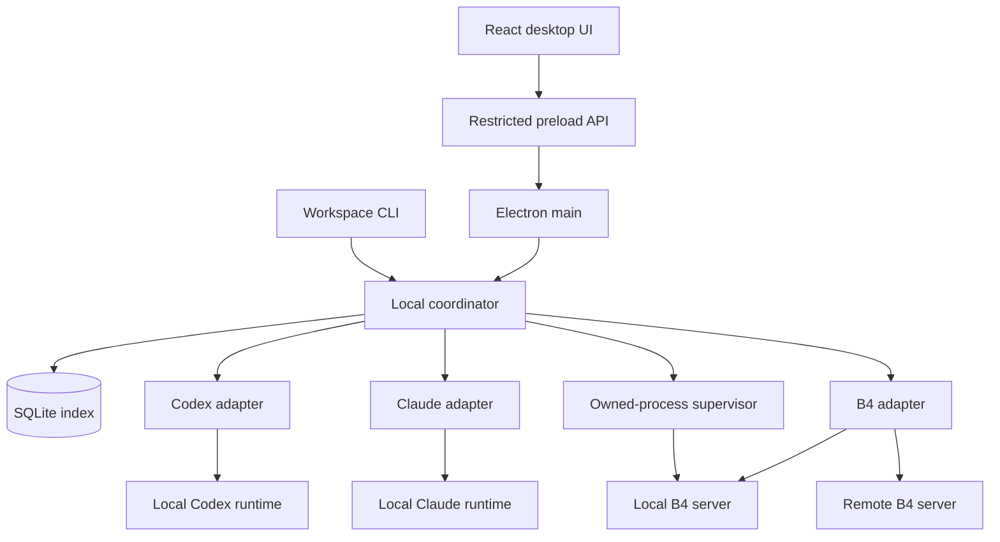

# Personal Agent Workspace: Technical Specification and Roadmap

**Purpose:** An implementation handoff for an agent building a personal macOS application.  
**Revision:** 1.0 — October 29, 2026.  
**Status:** Specification; the application has not been implemented or live-validated by this document.  
**Working names:** `Personal Agent Workspace` for the app and `agent-workspace` for its companion CLI. These names are provisional.

## 1. Read this first

Build a macOS app that lets its owner sign into the installed OpenAI Codex and Anthropic Claude Code runtimes, create and manage their threads, and use custom B4 agents in the same interface. A B4 server may run on the same Mac or at a configured remote endpoint.

**Local B4 means a local agent server calling configured model providers over the network. It does not mean running a local language model.** B4 retains its own model-provider configuration and credentials. Signing into Codex or Claude Code does not supply model credentials to a B4 server.

This is a personal tool. The first release needs no application account, subscription, billing system, hosted control plane, team model, or commercial onboarding. The primary interaction is a conversation thread. Process design, ingestion, work orders, and automated Kanban movement are later possibilities and must not determine the v0 data model or delivery sequence.

### Instructions for the implementing agent

1. Read this entire document and the target repository's instructions. Inspect existing code before creating a new application or replacing dependencies. Preserve unrelated work.
2. For a new repository, use the architecture in Section 4. Resolve routine implementation choices yourself and record material deviations in a short decision log.
3. Begin with milestone M0, then deliver the Codex vertical slice in M1. Prove the native integration before expanding the desktop abstraction.
4. Treat the internal interfaces and CLI commands in this document as proposed application contracts. Treat vendor APIs as versioned dependencies that must be checked against the selected executable, SDK, or B4 release.
5. Keep a milestone checklist and a compatibility manifest. Distinguish implemented, fixture-tested, live-tested, and blocked behavior. Never describe a mocked response as a working provider integration.
6. Use fixture tests by default. Live provider tests require the owner's configured account and an intentional test invocation; ordinary CI must not log in or consume inference automatically.
7. Continue independent implementation when a live account or Mac-only check is unavailable. Report the specific remaining gate; do not work around authentication or replace the required integration with a simulation.
8. Stop expanding scope when the release acceptance matrix passes. Deployment automation, iOS, boards, and orchestration are follow-on work.

### Definition of a useful v0

On one Mac, the owner can open the app, complete official provider sign-in, and keep usable Codex, Claude Code, managed local B4, and compatible remote B4 conversations side by side. The app can continue each conversation, display tool activity, collect supported runtime decisions, stop a turn, and recover useful state after reopening. The GUI and CLI manage the same locally owned B4 server.

## 2. Scope and requirements

### Required capabilities

| ID | Requirement | Observable result |
| --- | --- | --- |
| R01 | Packaged macOS desktop app | Launches from Finder on the documented target Mac without a development server. |
| R02 | Codex account connection | Reuses a valid local login or launches the official ChatGPT sign-in flow; a real thread runs under the intended account. |
| R03 | Claude account connection | Reuses a valid local login or launches official Claude sign-in; the SDK uses the same executable and authentication context. |
| R04 | Shared conversation interface | All required integrations appear in one thread list with their connection and execution identity visible. |
| R05 | Conversation lifecycle | Create, continue, rename locally, pin, search titles, archive, and unarchive application-managed threads. |
| R06 | Interactive execution | Stream text and tool activity, answer supported runtime requests, and explicitly stop active work. |
| R07 | Managed local B4 | Register a trusted project; inspect routes; start, stop, restart, inspect status, and view logs for its owned server. |
| R08 | Attached B4 endpoints | Converse with an existing local server and a compatible remote HTTPS endpoint without acquiring server ownership. |
| R09 | Durable local metadata | Preserve connection profiles, native thread mappings, organization, and cached display history across app restarts. |
| R10 | Recovery without duplicate sends | Reconcile uncertain turns and reconnect streams without automatically resubmitting prompts. |
| R11 | Shared management CLI | GUI and CLI contact one coordinator and observe the same B4 process registration and state. |
| R12 | Correct credential boundaries | Provider runtimes retain provider credentials; B4 endpoint secrets stay out of renderer state, command arguments, and ordinary logs. |

### Explicitly outside v0

- iOS, web access to the Mac, cloud synchronization, and an always-on remote relay.
- Work-order ingestion, task routing, process engines, swimlane rules, and automated handoffs.
- In-thread provider switching or automatic migration of hidden context between harnesses.
- Importing every pre-existing provider conversation, attachments, voice, and custom interactive artifact renderers.
- Parallel writes to the same project directory, automatic worktree creation, and a general scheduling system.
- Arbitrary B4 workflow/graph compatibility, a universal agent catalog, and a plugin marketplace.
- Automatic runtime installation or updates, cloud provisioning, deployment rollback, and remote host administration.
- App subscriptions, payments, team accounts, organization policy, marketing, and product analytics.

Support a small known configuration well. A missing provider executable must not prevent using another connection.

## 3. User experience

### 3.1 Main surfaces

| Surface | Required behavior |
| --- | --- |
| Threads sidebar | Recent and pinned threads; connection filter; title search; idle/running/waiting/reconnecting/error indicators. |
| Conversation | User and assistant messages, sanitized Markdown, collapsible tool calls/results, runtime prompts, composer, and Stop. |
| Thread header | Connection label, native runtime/agent identity, project directory or B4 route, and supported model selection. |
| Connections | Add/configure a runtime, local B4 project, or endpoint; show version, availability, auth state, and actionable errors. |
| Local servers | Start/stop/restart owned B4 servers, inspect route connections, and view redacted process logs. |
| Diagnostics | Executable paths, versions, auth mode, endpoint compatibility, and recent errors without secret values. |

Default the initial view to an empty Threads screen with **Add connection**. There is no separate application registration.

### 3.2 Connection setup

**Codex and Claude Code:** Detect installed executables when possible; allow an explicit path. Record the selected path and version. Show official installation guidance if absent. Offer reuse of an existing login and official sign-in when needed. Do not collect provider passwords in the application.

**Managed local B4:** Select a trusted project directory, resolve its project-installed CLI, choose launch mode and environment source, inspect routes, and select a standard agent route. State before inspection that loading the project can execute its configuration/modules. One server can back multiple route connections.

**Attached B4:** Enter the base URL, exact route key, display label, and optional endpoint authentication reference. For v0, create a secret with the companion CLI's hidden credential prompt and select its reference in the GUI; ordinary renderer forms do not collect raw secrets. Local HTTP is allowed for loopback; remote endpoints use HTTPS in v0. A connection check tests reachability and known protocol behavior without issuing an inference request. It must not equate a healthy server with valid model credentials.

### 3.3 Conversation rules

- A thread is permanently bound to one connection and native session. Starting with another provider creates another thread.
- Local title, pin, and archive changes do not rewrite native provider history. Archiving neither deletes history nor stops an active turn.
- A completed turn leaves the conversation idle and available for another message.
- Only one submitted turn may be active per native session. The user can edit the next draft locally, but v0 does not queue it into the provider.
- If a native transcript or B4 checkpoint is missing, retain the cached view, explain that continuation is unavailable, and offer a new thread.
- Render unsupported structured results as readable text or JSON. Do not execute content produced by an agent in the renderer.
- Use the runtime's supported model options; do not infer model entitlement from sign-in alone.

## 4. Architecture and repository structure

### 4.1 Chosen direction

For a new repository, use **Electron + React + TypeScript**, a local TypeScript coordinator, and SQLite. Keep the CLI, protocol adapters, and B4 process control in TypeScript. This is an implementation choice for a personal v0, not a requirement to build a plugin platform.

The initial packaging target is Apple Silicon macOS. Record the actual minimum OS, architecture, Node version, Electron version, and provider versions tested. Intel support, distribution signing/notarization, installers, and auto-updates can follow the first locally usable app.



### 4.2 Component responsibilities

| Component | Responsibility |
| --- | --- |
| Renderer | Views and local draft state; typed commands; no secrets, Node APIs, or direct process/network control. |
| Electron main/preload | Window/OS integration, validated IPC, external browser launch, and narrowly scoped UI capabilities. |
| Coordinator | Connection registry, adapter instances, active-session ownership, event normalization, database writes, runtime requests, and B4 supervision. |
| CLI | Local management client using the coordinator; no independent process registry or direct database writes. |
| Adapters | Translate native protocols into app commands/events while retaining native identities and meaningful capability differences. |
| Native runtimes | Agent execution, native transcripts, provider authentication, and runtime policy. |
| B4 server | Agent routes, tools, checkpoints, endpoint authorization, and model-provider calls. |

Use Electron context isolation and renderer sandboxing, disable Node integration, expose a narrow preload API, sanitize Markdown, restrict navigation/popups, and validate external URLs before opening them. Follow the official process and security guidance. [S01] [S02]

### 4.3 Local coordinator

Run one coordinator per macOS user. Both GUI and CLI use a Unix-domain socket in a private user-owned runtime directory. Validate the socket owner, protocol version, and every message. Do not listen on a public TCP interface.

Acquire a singleton lock before opening the database or claiming managed processes. A client either connects to the existing compatible coordinator or starts one and waits for readiness. A failed connection is not sufficient evidence that it is safe to kill a process or remove a lock. Handle simultaneous GUI/CLI startup deterministically.

The coordinator is an executable entry point usable from both a development checkout and the packaged app. For v0, configure a compatible external Node executable and resolve absolute executable paths explicitly. A Finder launch cannot depend on shell initialization. The reviewed B4 CLI source requires Node 24 or later; verify the installed package rather than assuming Electron's embedded runtime satisfies it. [S19]

### 4.4 Suggested layout

```text
apps/
  desktop/                 Electron main, preload, React UI
  cli/                     agent-workspace command entry point
packages/
  protocol/                App command/event schemas and shared types
  coordinator/             Service entry, session manager, process supervisor
  storage/                 SQLite schema, migrations, repositories
  adapters/
    codex/                 Generated native types and app-server bridge
    claude/                SDK bridge and native session handling
    b4/                    Agent Protocol client and SSE reconciliation
  test-fixtures/           Synthetic or scrubbed protocol fixtures
docs/
  compatibility.md         Versions, observations, limits, tested capabilities
  decisions.md             Material implementation decisions
  verification.md          Gate results and unresolved checks
```

Use a workspace package manager, strict TypeScript, shared runtime schemas, and a lockfile. Choose ordinary build/test tooling appropriate to the existing repository. Do not add a generic plugin loader or dependency-injection framework solely for three adapters.

## 5. Domain model and persistence

### 5.1 Core records

The coordinator alone writes the application database. Use migrations, transactions for state changes, and foreign keys. A logical schema follows; adapt physical tables to the implementation without losing these distinctions.

| Record | Required fields and invariants |
| --- | --- |
| Connection | App ID, kind, label, enabled flag, configuration/profile revision, runtime identity or endpoint, auth reference, discovered capabilities, compatibility status. |
| LocalServer | ID, canonical project path, Node/CLI paths, launch mode, environment references, requested/actual port, process generation, verified ownership, health, log location. |
| Thread | App ID, connection ID, native thread/session ID, native scope, title, working directory or B4 route, pinned/archived flags, created/updated timestamps. |
| Turn | App ID, thread ID, client operation ID, native turn/run ID when available, input reference, lifecycle state, acknowledgement state, outcome, timestamps. |
| DisplayItem | Stable app ID, thread/turn IDs, native item ID when present, role/type, display payload, local sequence, reconciliation provenance. |
| RuntimeRequest | App ID, native request ID, thread/turn IDs, adapter generation, request kind, pending/resolved/expired state, safe display payload. |
| Draft | Thread ID and unsent user text. Never treat a saved draft as a dispatched request. |

Native identities are namespaced by connection/native scope. Identical native IDs from different endpoints or account profiles must not collide. Do not rely on a globally unique B4 thread ID across unrelated servers.

A B4 connection references a server/endpoint profile and an exact route key. Several route connections may reference one managed server. Changing a profile to a different server, account context, or route must not silently retarget old threads. Create a new connection when native identity changes; ordinary executable upgrades require a compatibility recheck.

### 5.2 Sources of truth

| Data | Authority |
| --- | --- |
| App titles, pin/archive flags, connection membership | Workspace SQLite database |
| Codex execution and native history | Selected Codex runtime and its native storage |
| Claude execution and native history | Selected Claude runtime and its native transcripts |
| B4 thread state/checkpoints | Connected B4 server and its configured stores |
| Cached message display | Workspace cache, explicitly marked stale/offline when unreconciled |
| Provider tokens and refresh | Provider-owned credential mechanism |
| B4 endpoint secret | macOS credential store, referenced by ID from app metadata |

Do not reconstruct a supposedly resumable native session from a cached transcript alone. Keep application metadata under the user's Application Support directory and restrict file permissions. Transcripts remain sensitive local content even when they contain no authentication tokens; v0 does not sync them to a cloud service.

### 5.3 State model

Keep **connection availability**, **authentication**, **transport**, **turn lifecycle**, and **outcome certainty** separate. A disconnected viewer does not prove that a turn stopped.

```ts
// Proposed internal types; not vendor wire formats.
type ConnectionStatus =
  | "unconfigured" | "connecting" | "ready"
  | "offline" | "incompatible" | "error";

type AuthStatus =
  | "not_required" | "unknown" | "required"
  | "authenticating" | "authenticated" | "error";
type TransportStatus =
  | "disconnected" | "connecting" | "connected" | "reconnecting";

type TurnStatus =
  | "submitting" | "running" | "waiting_for_user"
  | "stopping" | "reconciling" | "terminal";

type TurnOutcome = "completed" | "cancelled" | "failed";
type SubmissionState = "prepared" | "acknowledged" | "unknown";
```

An unresolved turn remains `reconciling` with an unknown submission/outcome where necessary; do not force it into success or cancellation. A thread is idle only when no unresolved active turn remains. Thread archive status is independent of execution status.

## 6. Internal adapter and client contracts

Keep the normalized surface small. It supports display, control, and recovery, while native details remain inside each adapter.

```ts
// Illustrative app interface. Define concrete discriminated schemas in protocol/.
interface AgentAdapter {
  inspectConnection(): Promise<ConnectionInspection>;
  createSession(input: NewSessionInput): Promise<NativeSessionRef>;
  loadSession(ref: NativeSessionRef): Promise<SessionSnapshot>;
  sendTurn(ref: NativeSessionRef, input: TurnInput): Promise<SubmissionReceipt>;
  interrupt(ref: NativeSessionRef, turn: ActiveTurnRef): Promise<StopReceipt>;
  respond(ref: RuntimeRequestRef, response: RuntimeResponse): Promise<void>;
  reconcile(ref: NativeSessionRef): Promise<ReconcileResult>;
  events(): AsyncIterable<AdapterEvent>;
  dispose(): Promise<void>;
}
```

Authentication and server supervision are separate services. B4 does not need a fictitious provider-login method; a Codex adapter does not need B4 process controls. A `dispose` call closes adapter resources and is never an implicit remote cancel. Local runtime teardown must be handled by the coordinator's explicit shutdown policy because it can end local execution.

### 6.1 Capabilities

Store verified capabilities per connection: streaming, native resume, history retrieval, explicit interruption, reconnect, permission decisions, user questions, and model selection. Capability values may be supported, unsupported, or not yet verified. Disable unavailable actions with an explanation; never emulate them silently.

For each adapter event, preserve connection/thread/turn identity, local sequence, native identifiers when available, adapter generation, and event kind. Suggested event kinds:

```text
connection.changed
session.created
turn.acknowledged
message.started
message.delta
message.completed
tool.started
tool.completed
runtime_request.opened
runtime_request.resolved
runtime_request.expired
turn.state_changed
turn.finished
reconciliation.snapshot
adapter.error
```

Only the adapter maps native success/error/cancel/park signals into app state. A stream closing or an event named `done` is not by itself sufficient proof of success.

### 6.2 GUI/CLI command surface

Implement typed commands for connection inspection/authentication, thread creation and organization, send/stop, request responses, server registration/lifecycle, and diagnostics. Commands carry a client operation ID and validate their arguments at the coordinator boundary.

Use this small versioned envelope. `method` is an allowlisted discriminated command with its own parameter schema, not an arbitrary function name. Read-only commands may omit `operationId`; all mutations require it. A transport retry retains the original operation ID.

```ts
type CommandEnvelope = {
  protocolVersion: 1;
  kind: "command";
  requestId: string;
  operationId?: string;
  method: string;
  params: unknown;
};

type ResponseEnvelope = {
  protocolVersion: 1;
  kind: "response";
  requestId: string;
} & (
  | { ok: true; result: unknown }
  | { ok: false; error: { code: string; message: string; details?: unknown } }
);

type EventEnvelope = {
  protocolVersion: 1;
  kind: "event";
  epoch: string;
  sequence: number;
  event: AdapterEvent;
};
```

Assign a new event epoch after coordinator restart. A client snapshot includes its epoch and sequence; later events must follow that position. A gap, changed epoch, or expired bounded replay buffer requires a fresh snapshot. A durable distributed event bus is unnecessary for v0.

The coordinator may deduplicate a repeated **local command** by operation ID. This does not establish upstream exactly-once delivery. Subscription to coordinator events uses an app-owned sequence and a snapshot fallback. Do not confuse that local cursor with a native provider replay cursor.

## 7. Codex adapter

Use the installed Codex app-server over local stdio. Generate protocol types/schemas from the selected executable and pin the tested combination. Its documented local authentication surface and continued support for existing local applications inform this design; verify the intended personal integration in M0/M1 against current official guidance and the actual runtime. Do not substitute credential extraction if that path is unavailable. [S03] [S04] [S05]

| Action | Native operation |
| --- | --- |
| Start bridge | `codex app-server` |
| Handshake | `initialize`; await success; send `initialized` |
| Account status | `account/read` |
| Official sign-in | `account/login/start` with `{ "type": "chatgpt" }`; open returned URL in system browser |
| Login result | `account/login/completed` and `account/updated` |
| New/continued conversation | `thread/start`, `thread/resume` |
| Send | `turn/start` |
| Read history | `thread/read` and supported paginated history methods |
| Stop | `turn/interrupt` |
| Runtime question | Handle `item/tool/requestUserInput` |
| Runtime permissions | Respond to native command/file approval requests using their exact request IDs |

Consume item deltas, final items, and turn completion. Store the returned native thread ID and retain native item/turn IDs for reconciliation. Honor `serverRequest/resolved` by invalidating the corresponding prompt. Unsupported permission or MCP requests need valid explicit decline responses, not an unanswered promise. Keep stdout for protocol decoding and stderr for bounded diagnostics. Generate types with the runtime's `generate-ts` or `generate-json-schema` facility; avoid experimental API opt-ins unless a required behavior needs them. [S03]

Keep authentication with Codex. Do not read/copy token files or recreate refresh logic. Disconnecting the app is distinct from provider logout because credentials may be shared with other local clients. Verify auth mode before execution and show allowance/authentication failures without silently switching to API billing. Treat app-server maturity as a compatibility risk, with actionable errors after an incompatible executable change. [S04] [S05]

## 8. Claude Code adapter

Use the TypeScript Agent SDK with the selected unmodified local Claude Code executable. Run `claude auth status` and `claude auth login` through that executable and the same effective user/configuration environment used by the SDK, including `CLAUDE_CONFIG_DIR` if configured. Recheck status after sign-in. [S06]

Anthropic's October 7, 2026 guidance states that signed-in SDK and headless usage continue to use Claude plan allowances. API credentials are a separate billing mode. Preserve intended subscription authentication and explicitly resolve conflicting inherited API credentials before running. This is a version-sensitive integration check, not a promise of unlimited usage. [S07] [S08]

### 8.1 Session settings

Use the SDK's streaming-input interface and these configuration intentions, verified against the pinned types:

```ts
// Configuration sketch, not a complete SDK implementation.
const options = {
  cwd: selectedProjectDirectory,
  pathToClaudeCodeExecutable: selectedClaudeExecutable,
  systemPrompt: { type: "preset", preset: "claude_code" },
  settingSources: ["user", "project", "local"],
  permissionMode: "default",
  persistSession: true,
  includePartialMessages: true,
  canUseTool: appPermissionBridge,
  ...(nativeSessionId ? { resume: nativeSessionId } : {}),
};
```

The option is `settingSources`. Capture the emitted `session_id`; `resume` identifies an existing session. Retain final messages and result events as well as partial deltas. A session ID does not recover a deleted native transcript. [S09] [S10] [S13]

Selecting a project deliberately permits its configured instructions, hooks, and tools to load. Do not present `settingSources: []` as complete isolation. If supplying an explicit SDK environment, preserve required inherited values; the current option replaces rather than merges the environment. Avoid `--bare` for this sign-in mode because it skips subscription OAuth/Keychain loading. [S09] [S11] [S14]

### 8.2 Runtime interaction

- Bridge `canUseTool` to app requests and honor its cancellation signal. Existing provider permission rules can resolve tool calls without invoking this callback; do not claim that every tool is intercepted. [S12]
- Implement `AskUserQuestion` as structured user input, separate from a tool allow/deny decision. Preserve the native answer schema. [S12]
- MCP elicitation has a separate `onElicitation` path. For v0, show it as unsupported and explicitly decline it using the SDK contract. [S09]
- Feed at most one submitted turn into a session. Do not preload further user messages into the SDK stream. Native interruption does not clear an already queued message stream. [S09] [S10]
- Stop invokes the supported interrupt operation, clears any unsent submission queue, and preserves the user's locally edited draft. Only a deliberate later Send may submit it.

Do not use blanket permission bypass to make the integration appear functional. Show the effective provider policy and return native decisions exactly once for the current request generation.

## 9. B4 adapter and local execution

### 9.1 Supported initial contract

Implement the **B4 Node Agent Protocol** once for local and compatible remote servers. The first conversational slice supports standard `agent()` routes using the ordinary message input shape. Other route kinds require their own verification and are outside the v0 guarantee. A deployment's URL alone does not establish protocol compatibility. [S15] [S17]

For a trusted local project, run `b4 routes --json --cwd <project>`. Construct the protocol route from `id` and `kind`, for example `/research#agent`. Discovery loads project modules; inventory does not provide complete input schemas. For remote profiles, enter the route explicitly: the reviewed HTTP contract has neither a general route catalog nor a global thread-list endpoint. Keep an app-owned index of known thread IDs. [S17] [S20]

### 9.2 HTTP operations

Resolve these paths relative to the configured API base, preserving any deployment base path. Encode thread IDs as path segments; the route key is a JSON value.

| Operation | Method and path | Notes |
| --- | --- | --- |
| Create native thread | `POST /threads` | Optional metadata; store the returned ID. The server generates the ID. |
| Inspect thread | `GET /threads/:id` | Reconcile native thread state. |
| Submit streaming turn | `POST /threads/:id/runs/stream` | Send exact route and input; parse SSE. |
| Retrieve checkpoint state | `GET /threads/:id/state` | A 404 before the first checkpoint does not prove that the thread is missing. |
| Retrieve turns | `GET /threads/:id/turns` | Honor warnings/truncation; do not promise unlimited history. |
| Reattach viewer | `GET /threads/:id/runs/stream` | Read-only snapshot/live stream; does not submit another turn. |
| Retrieve pending requests | `GET /threads/:id/pending_interrupts` | Distinguish parked permission requests from cancelled execution. |
| Resolve permissions | `POST /threads/:id/resume` | Supply route and a complete current pending set. |
| Explicitly cancel | `POST /threads/:id/cancel` | Targets active work on that thread. |

The reviewed source and protocol documentation are the implementation references. Recheck request/response schemas against the chosen release; do not assume broader protocol parity with another server implementation. [S15] [S17]

Example submitted message:

```json
{
  "route": "/research#agent",
  "input": {
    "messages": [{ "role": "user", "content": "Summarize this project." }]
  }
}
```

Example current permission resolution:

```json
{
  "route": "/research#agent",
  "resume": [
    { "interruptId": "native-id", "status": "resolved", "payload": "once" }
  ]
}
```

Current permission decisions are `once`, `always`, and `deny`, or a cancelled entry with `{ "interruptId": "native-id", "status": "cancelled" }`. Fetch the complete pending set and answer each pending ID once. Respect route restrictions and actual persistence scope for `always`; do not label it globally effective. Echo an opaque `grant` on its matching entry, not the outer body, when present. On stale/conflict responses, refresh rather than replaying the same decision. Arbitrary JSON question answers and client-provided tool interruptions are not part of this v0 adapter. [S17] [S23]

### 9.3 SSE and recovery

Parse incremental SSE chunks correctly across network boundaries. Map text, tool calls/results, native errors, parked execution, and terminal outcomes distinctly. A native `done` event can accompany several outcomes; inspect its content and current state. [S15] [S17]

Closing an Agent Protocol viewer does not necessarily cancel execution. Reconnect through the read-only stream operation and reconcile persisted turns/state. There is no reviewed `Last-Event-ID` replay guarantee. A snapshot replaces or reconciles the current display projection; never append it as if every item were new. Do not render permission-resume input as a new user message. The native `interrupted` state can mean cancellation or a parked request, so inspect pending interruptions. [S15] [S17]

Persist a route with its native thread mapping. A server running again does not prove that its old checkpoint store is still present. A lost server process ends in-memory execution; persistence can retain conversation state without retaining an active run.

### 9.4 Server ownership

| Mode | Lifecycle authority |
| --- | --- |
| Managed local project | Coordinator may start/stop/restart its verified owned process tree. |
| Attached local endpoint | App may connect/disconnect and request protocol-level turn cancellation; it must never kill the server process. |
| Remote endpoint | App may connect/disconnect and request protocol-level turn cancellation; it does not administer the host. |

Use one server registration per canonical project/launch profile, shared by its route connections. Prefer one active managed instance per project in v0. Capture startup generation, verified child identity, actual port, and readiness. A PID or an open port alone does not establish ownership.

### 9.5 Actual launch behavior

Resolve the project-installed CLI without implicitly downloading a package. Spawn with an executable and argument array, a deliberate working directory, and an explicit environment policy.

| Mode | Invocation and important behavior |
| --- | --- |
| Development | `b4 dev --port <port> --env-file <path>` from the project directory. Hot reload can interrupt active work. |
| Source without reload | Run required type generation/verification, then `b4 start --host 127.0.0.1 --port <port>` with the intended child environment. |
| Built Node artifact, later | `b4 build` produces `.b4/build/server.mjs`; launch that artifact with Node. `b4 start` serves source. |

In the reviewed source, `dev` and `start` do not accept `--cwd`; set the process working directory. `start` defaults to a non-loopback bind, does not load `.env`, and does not perform type generation, so the coordinator must handle these explicitly. Use dotenv parsing without shell evaluation when resolving an environment file for source mode. Confirm exact flags against the installed version. [S16] [S21]

Default managed execution to source mode without reload. Development mode is an explicit choice because a file change can replace the active runtime. Reject conflicting launch profiles while a managed instance for that project is active.

Node execution defaults include `.b4/threads.sqlite` and `.b4/checkpoints.sqlite` unless the project overrides them. Standard B4 agents can retain conversation state without a cloud database. Preserve `.b4` across start/stop; do not impose a new database service for the personal v0. [S22] [S24]

### 9.6 Authentication boundary

Endpoint authentication is configured per server/proxy; it is not a universal B4 account login. Store endpoint secrets through a credential-store reference and send them only to the configured origin. Do not forward credentials across redirects. The server retains model-provider keys. Ensure the selected deployment protects read/state/management/cancel paths as well as execution; execution middleware alone is not a whole-endpoint access boundary. [S18]

## 10. Execution, recovery, and process invariants

These rules are release requirements, not optional hardening.

### 10.1 Submission and concurrency

1. Allocate a client operation ID and persist the prepared turn before dispatch.
2. Send once, record a native acknowledgement/identity when available, and stream events into the display projection.
3. If the request may have reached the runtime but acknowledgement is lost, mark the submission unknown and reconcile. Do not automatically send again.
4. If the runtime cannot establish the result, show that uncertainty and require deliberate recovery. Another dispatch must first resolve active-run uncertainty or use a separate safe session/context that respects the locks below.
5. Allow at most one active turn per native session. Serialize writable Codex/Claude runs using the same canonical working directory; retain the lock through waiting/unknown states until safely resolved. Distinct directories can run independently. This lock does not control external tools modifying the project.

Use stable native event IDs for deduplication when present. Where they are absent, use adapter-specific snapshot reconciliation; timestamp/text matching alone is not a valid exactly-once guarantee.

### 10.2 Runtime requests

Associate each request with its connection, native session, native request ID, and adapter/process generation. Only a current pending request can be answered. Race duplicate clicks through one coordinator state transition. If submission of a decision has an uncertain outcome, reconcile native state before retrying.

After runtime restart, old requests are expired until the runtime presents current requests. While the native request transport is disconnected, disable answering until the current pending state is confirmed. Never automatically replay a cached approval. Unknown request types must get a supported explicit decline or a visible incompatibility failure; they must not leave a hidden promise hanging indefinitely.

### 10.3 Lifecycle behavior

| Event | Required behavior |
| --- | --- |
| Renderer reload/window close | Coordinator and active work continue; reopening rebuilds the UI from snapshot/events. |
| Full Quit with local work | Offer keep-running-in-background or stop-owned-local-work-and-quit. Clearly describe remote B4 detach versus explicit cancellation. |
| GUI or CLI exits | Do not kill attached servers or another client's coordinator accidentally. |
| Coordinator/runtime failure | Restart only when safe, load persisted mappings, reconcile native state, expire obsolete requests, and avoid duplicate submission. |
| Mac sleep/wake | Reconnect and reconcile; show local interruption/unavailability honestly. Remote execution may continue independently. |
| Port conflict or stale PID | Report the conflict and verify ownership; do not terminate an unrelated process. |
| Missing native history | Show cache as cache; offer a new thread rather than claiming native resume succeeded. |

Shutdown signals go only to verified owned process trees, with a bounded graceful interval before any escalation. Never claim an existing process solely because it occupies a remembered port. After a coordinator crash, do not automatically launch a duplicate server while ownership of an earlier instance remains unresolved.

## 11. CLI contract

The new `agent-workspace` CLI is part of this application. It wraps coordinator operations; these commands are not existing B4 CLI commands.

```sh
agent-workspace doctor
agent-workspace credential add remote-research

agent-workspace server add ./my-b4-agent --name research
agent-workspace server list
agent-workspace server start research
agent-workspace server status research
agent-workspace server logs research --follow
agent-workspace server restart research
agent-workspace server stop research

agent-workspace connection add \
  --name remote-research \
  --url https://agent.example.com \
  --route '/research#agent'
```

Implement `--json` for doctor, list, status, and mutation results so agents can consume stable structured output. Return nonzero exit codes for unavailable dependencies, invalid configuration, compatibility failures, and unsuccessful lifecycle operations. Human-readable output may explain remediation; machine output must preserve error codes.

`credential add <label>` reads the secret through a hidden terminal prompt, transmits it only over the protected local coordinator channel, and writes it through `SecretStore` to Keychain. Its response contains a credential reference, never the value. The GUI selects existing application credential references. Credentials never appear in CLI arguments, JSON results, or ordinary renderer state. Persist executable/argument arrays instead of shell command strings. `start` is idempotent for an already-running owned registration. `stop` acts only on that registration. GUI and CLI must observe the same status and logs after either starts the server.

Do not use `b4 run --url` as the desktop conversation substrate: the reviewed command creates a fresh CLI thread and does not supply the required continuing interactive thread behavior. Use the Agent Protocol adapter. [S16]

## 12. Errors, diagnostics, and data safety

Define stable internal error codes for at least: missing executable, incompatible version/protocol, auth required, auth-mode conflict, allowance/rate limit, endpoint unavailable, unsupported capability, native session missing, stale runtime request, submission unknown, owned-process conflict, and cancellation unconfirmed.

Show a user-facing explanation and a specific next action. Preserve safe native error details for diagnosis. A transient connection failure must not trigger API-billing fallback, a new native session, a process kill, or an automatic re-send.

Keep provider secrets in provider mechanisms. Keep endpoint secrets in macOS Keychain behind a small coordinator-owned `SecretStore` interface. Redact known credential values, authorization headers, and authentication URLs containing sensitive parameters from diagnostics. Do not persist full environment dumps or credential-bearing raw protocol logs. Redaction is not proof that arbitrary project output contains no secrets; collect the minimum diagnostic content needed.

Configuration and metadata can reference environment file paths and secret IDs. Do not copy `.env` contents into the application database. Use bounded/rotating process logs. No analytics or remote crash uploading is required for this personal release.

## 13. Implementation roadmap

All items below start unchecked. The milestones are dependency gates, not elapsed-time estimates. Each milestone should leave a runnable increment and a brief verification record.

### M0 — Establish the build and compatibility baseline

**Dependencies:** None.  
**Purpose:** Resolve the integration facts that could invalidate the implementation.

- [ ] Inspect the repository; create the minimal workspace only if needed.
- [ ] Record target Mac/OS/architecture, Node, provider executables, Claude SDK, and B4 versions.
- [ ] Check the selected Codex schema and official local sign-in path.
- [ ] Check Claude auth status and the SDK/executable pairing without reading credential contents.
- [ ] Identify a trusted local B4 project with one standard agent route and the needed provider environment.
- [ ] Establish a fixture-test runner, strict TypeScript check, and minimal coordinator entry point.
- [ ] Write `docs/compatibility.md`, including the reference B4 commit below and the actual installed version.

**Exit gate:** Dependencies are available or individually marked blocked with a precise setup action. Protocol types/configuration are grounded in selected versions. No real integration is represented by a mock. Authentication checks alone do not count as successful inference.

### M1 — Deliver one real Codex desktop conversation

**Dependencies:** M0 Codex baseline.  
**Purpose:** Establish a useful end-to-end application before adding providers.

- [ ] Implement Codex handshake, account status, official sign-in, start/resume, stream, stop, history, and runtime requests.
- [ ] Build Electron main/preload/React boundaries and the shared coordinator socket.
- [ ] Implement the initial SQLite migration, connection registry, thread/native-ID mapping, turn record, and cached display items.
- [ ] Build Threads, conversation/composer, connection setup, and runtime request UI.
- [ ] Support both new local sign-in and reuse of an existing login.
- [ ] Persist and reopen a real thread using the same native ID.
- [ ] Exercise renderer reload/window close without duplicating or implicitly cancelling a turn.

**Exit gate:** From the desktop, the owner can sign in, run a real streamed Codex turn, resolve a supported runtime request, stop work, and continue the same conversation after reopening. A minimal packaged Finder launch must be tried here to expose path/runtime problems early.

### M2 — Add Claude Code with equivalent core behavior

**Dependencies:** M1 contracts/UI; M0 Claude baseline.  
**Purpose:** Validate that the shared interface preserves a second harness's real behavior.

- [ ] Implement official auth status/login with consistent executable and environment selection.
- [ ] Add SDK session creation, streaming input, `session_id` persistence, native resume, final-result handling, and stop.
- [ ] Implement tool permission and user-question bridges; explicitly decline unsupported elicitation.
- [ ] Detect auth-mode conflicts before execution and preserve the user's intended account mode.
- [ ] Verify drafts remain unsent while a turn runs and after interruption.
- [ ] Display Codex and Claude threads simultaneously with separate native identities.

**Exit gate:** A real Claude conversation streams, pauses for a supported decision, stops, and resumes after app restart. Account/configuration identity matches the selected runtime. Adding Claude has not regressed the working Codex path.

### M3 — Add B4 local and remote conversation adapters

**Dependencies:** M1 data/UI; M0 B4 baseline. Can be developed alongside M2 after shared contracts stabilize.  
**Purpose:** Use custom agents in the same thread experience.

- [ ] Add endpoint profiles, exact route binding, endpoint secret references, and capability checks; implement the minimal hidden-prompt `credential add` CLI path for remote authentication.
- [ ] Implement native thread creation, streaming input, state/turn reads, permission resolution, and explicit cancellation.
- [ ] Implement read-only reattachment with snapshot reconciliation and unknown-submission handling.
- [ ] Test against an existing local standard-agent server, then a compatible remote HTTPS Node endpoint.
- [ ] Verify standard-agent conversation persistence across a B4 server restart with its stores preserved.
- [ ] Show unsupported route/protocol behavior as a compatibility result rather than silently degrading it.

**Exit gate:** Local and remote B4 threads coexist with harness threads. Stream loss does not resubmit a prompt. A parked permission is distinguishable from cancellation. Remote testing uses the real endpoint credentials while model credentials remain on the B4 server.

### M4 — Add managed B4 execution and the shared CLI

**Dependencies:** M3's local adapter path; coordinator from M1. A pending remote endpoint check does not block this milestone.  
**Purpose:** Run local custom agents without maintaining a separate terminal session.

- [ ] Implement local project registration, trusted route inspection, and shared server/route records.
- [ ] Implement explicit Node/CLI paths, environment resolution, loopback binding, readiness, logs, and child ownership.
- [ ] Support development and source-without-reload launch profiles with their actual flag/environment differences.
- [ ] Add GUI server controls and the CLI in Section 11.
- [ ] Make concurrent GUI/CLI starts converge on one coordinator and one owned server registration.
- [ ] Confirm attached local servers remain alive after disconnect, workspace Quit, and attempts to invoke owned-server controls.

**Exit gate:** Start from the GUI and inspect/stop from the CLI, then reverse the sequence. Both clients report the same server, port, route connections, and logs. Restart preserves B4 stores. Port conflicts and stale ownership records do not kill unrelated processes.

### M5 — Complete daily-use behavior and recovery

**Dependencies:** M2, M3, M4.  
**Purpose:** Make the full personal workflow dependable.

- [ ] Complete rename, pin, archive/unarchive, title search, connection filtering, and local draft persistence.
- [ ] Add safe account/endpoint identity changes, expired auth, allowance errors, and compatibility errors.
- [ ] Implement all lifecycle outcomes from Section 10, including full Quit and wake reconciliation.
- [ ] Test coordinator/runtime crash paths, ambiguous sends, stale decisions, and snapshot deduplication.
- [ ] Verify workspace write locks across local harness threads in the same directory.
- [ ] Complete diagnostic redaction and bounded logs; inspect renderer IPC and credential boundaries.

**Exit gate:** Critical recovery/ownership cases pass fixture tests, and the live Mac matrix has no unreported failures. Any uncertain native outcome remains visibly uncertain instead of being called successful.

### M6 — Package and accept the personal v0

**Dependencies:** M5.  
**Purpose:** Produce the application the owner can actually open and use.

- [ ] Produce a local `.app` bundle and package/locate the coordinator and companion CLI predictably.
- [ ] Verify Finder launch with executable paths outside the interactive shell PATH.
- [ ] Document prerequisites, build/run/package commands, first sign-in, B4 environment setup, and CLI use.
- [ ] Run the release acceptance matrix below on the target Mac.
- [ ] Record exact versions, performed checks, known limits, and any blocked live checks in `docs/verification.md`.
- [ ] Deliver the app/build instructions and source changes; keep follow-on features out of this release.

**Exit gate:** Every mandatory acceptance row passes on the target Mac. If a required live check is unavailable, deliver the implementation with that gate clearly open; do not label the release fully validated.

## 14. Verification and release acceptance

### 14.1 Test strategy

Automate the behavior that is easy to break and difficult to observe: protocol parsing, event reduction, snapshot reconciliation, ambiguous acknowledgement, decision races, stale generations, shared-directory locks, auth-mode selection, and process ownership. Use synthetic or scrubbed fixtures and a controllable local HTTP/SSE server. Fixtures must include chunk boundaries, repeated events, errors, cancellation, and parked requests.

Integration tests should run the real coordinator with an isolated temporary database and fixture adapters. Run only focused UI tests for the main conversation, sign-in entry points, requests, and server controls. Do not spend the initial build writing tests that merely mirror trivial view implementation.

Keep a separate opt-in live smoke-test procedure. Browser authentication, Keychain, real provider execution, Finder packaging, process lifecycle, and Mac sleep/wake require the actual Mac environment. Linux/CI fixture results are not evidence that those Mac behaviors passed.

### 14.2 Mandatory acceptance matrix

| ID | Scenario | Pass condition | Evidence |
| --- | --- | --- | --- |
| A01 | Finder launch | Packaged app opens without a dev server and resolves selected runtimes. | Live Mac |
| A02 | Codex login and use | Official login or existing login produces a real turn under the intended account; same native thread continues. | Live Mac |
| A03 | Claude login and use | Official login/status and SDK share the intended context; real turn and native resume work. | Live Mac |
| A04 | Shared thread list | Codex, Claude, local B4, and remote B4 conversations retain distinct identities and correct labels. | Live Mac |
| A05 | Thread organization | Rename, pin, title search, archive/unarchive, and draft state survive restart. | Local integration/UI |
| A06 | Runtime decisions | Supported allow/deny/question actions reach the correct native request at most once; stale requests cannot be answered. | Fixtures + live adapters |
| A07 | Explicit Stop | Active execution receives native interruption/cancel; resulting state is confirmed or visibly unresolved; drafts are not submitted. | Fixtures + live adapters |
| A08 | B4 managed local | GUI and CLI operate one owned server; actual provider-backed conversation works; `.b4` state survives restart. | Live Mac |
| A09 | B4 attached local | Conversation and protocol cancellation work; disconnect/Quit never kills the external server. | Local integration + Mac |
| A10 | B4 remote | Compatible HTTPS endpoint supports real streaming and continuation with endpoint auth. | Live remote |
| A11 | Stream loss | Reattachment/reconciliation does not duplicate user input or display snapshots as new messages. | Fixtures + live B4 |
| A12 | Lost acknowledgement | Submission becomes unknown; reconciliation is attempted; no automatic repeat occurs. Unresolved outcomes remain visible, and deliberate recovery respects active-session/directory locks. | Fault injection |
| A13 | App/runtime restart | Local index returns; resumable histories continue; missing histories and expired requests are identified accurately. | Integration + Mac |
| A14 | Process ownership | Concurrent starts converge; port conflicts, stale records, and reused PIDs cannot kill unrelated processes. | Process integration |
| A15 | Auth and usage errors | Expired login, auth-mode conflict, and allowance failures are actionable; no silent billing-mode switch. | Fixtures + available live cases |
| A16 | Renderer/secret boundaries | No raw process API or credential access in renderer; known secrets absent from app-generated diagnostics and arguments. | Code review + focused checks |
| A17 | Window/Quit/wake | Window close preserves work; full Quit choice is honored; wake reconciles local/remote state honestly. | Live Mac |
| A18 | Project concurrency | Two writable local harness turns in one canonical directory do not overlap through this app. | Integration |

The verification record must identify which live cases were actually exercised. Do not force a paid allowance exhaustion merely to test an error UI; use a faithful fixture for that condition.

## 15. Follow-on roadmap after v0

These increments are intentionally separate and require a later prioritization decision.

| Increment | Proposed work | Entry condition |
| --- | --- | --- |
| B4 deployment recipe | Save a project target, structured build/deploy commands, environment references, and endpoint registration; expose the same action in GUI/CLI. | v0 is in daily use and one real deployment workflow is selected. |
| Lightweight boards | Optional manual columns and thread grouping; preserve threads as the execution unit. | The owner has concrete organization needs from daily use. |
| Execution conveniences | Additional route/input schemas, richer artifacts, automatic worktrees, and broader history import. | A specific repeated manual task justifies each addition. |
| iOS companion | Review messages and respond to requests through an explicitly designed secure relay or reachable service. | Remote connectivity, credential boundaries, and sleep/offline behavior are designed separately. |
| Personal automation | Explicit process rules and agent handoffs with reviewable transitions. | Observed workflows justify a process model. |

For deployment, wrap a verified target-specific workflow; do not invent a universal `b4 deploy` command. The reviewed CLI provides build targets, while deployment depends on the target tooling. Initial v0 remote use is accomplished by attaching an already deployed compatible endpoint. [S16]

## 16. Compatibility baseline and source register

The research baseline is **October 29, 2026**. B4 source observations refer to commit `547c4ecbf3f7f7bf5662ed78522fbe8f6fe0b522`, whose CLI package declares version `0.15.7` and Node `>=24.0.0`. This is a reviewed source snapshot, not a claim about the currently published package. [S19]

At M0, record actual versions and verify auth behavior, schema generation, SDK options, B4 route payloads, interruption/resume behavior, and launch defaults. Prefer a minimal compatibility adjustment over broadening the product scope. If official behavior conflicts with this snapshot, document the evidence and update the affected adapter contract; do not guess or bypass the runtime.

The following are upstream technical references. The architecture, milestone order, and internal application contracts are design decisions in this specification.

| ID | Reference | Primary use |
| --- | --- | --- |
| S01 | [Electron process model][S01] | Desktop process boundaries. |
| S02 | [Electron security guidance][S02] | Renderer isolation and untrusted content. |
| S03 | [Codex App Server][S03] | Native protocol, authentication, threads, turns, runtime requests. |
| S04 | [Codex authentication][S04] | Provider-owned login and credential context. |
| S05 | [Codex developer commands][S05] | Generated schemas and command maturity. |
| S06 | [Claude Code CLI reference][S06] | Official authentication commands. |
| S07 | [Use the Claude Agent SDK with a Claude plan][S07] | Plan usage guidance updated October 7, 2026. |
| S08 | [Claude Code with Pro or Max][S08] | Authentication and separate API billing. |
| S09 | [Claude TypeScript Agent SDK][S09] | SDK options, control, callbacks, and session events. |
| S10 | [Claude streaming input][S10] | Interactive input and interruption. |
| S11 | [Claude Code features in the SDK][S11] | Project instructions/settings behavior. |
| S12 | [Claude permissions and user input][S12] | Runtime approval and question bridges. |
| S13 | [Claude SDK sessions][S13] | Native history and session continuation. |
| S14 | [Programmatic Claude Code][S14] | Headless operation and bare-mode limits. |
| S15 | [B4 Agent Protocol][S15] | HTTP/SSE conversation contract. |
| S16 | [B4 CLI][S16] | Existing route/run/build commands. |
| S17 | [B4 HTTP runtime at reviewed commit][S17] | Concrete endpoints, validators, and state semantics. |
| S18 | [B4 security architecture][S18] | Endpoint and execution authorization. |
| S19 | [B4 CLI package at reviewed commit][S19] | Source package version and Node requirement. |
| S20 | [B4 routes command at reviewed commit][S20] | Local route inventory and discovery. |
| S21 | [B4 start command at reviewed commit][S21] | Source launch defaults; compare the adjacent dev command. |
| S22 | [B4 persistence][S22] | Local stores and conversation persistence. |
| S23 | [B4 approval grants][S23] | Permission continuation and grant handling. |
| S24 | [B4 route execution at reviewed commit][S24] | Default store resolution and standard-agent execution. |

[S01]: https://www.electronjs.org/docs/latest/tutorial/process-model
[S02]: https://www.electronjs.org/docs/latest/tutorial/security
[S03]: https://learn.chatgpt.com/docs/app-server
[S04]: https://learn.chatgpt.com/docs/auth
[S05]: https://learn.chatgpt.com/docs/developer-commands
[S06]: https://code.claude.com/docs/en/cli-reference
[S07]: https://support.claude.com/en/articles/15036540-use-the-claude-agent-sdk-with-your-claude-plan
[S08]: https://support.claude.com/en/articles/11145838-use-claude-code-with-your-pro-or-max-plan
[S09]: https://code.claude.com/docs/en/agent-sdk/typescript
[S10]: https://code.claude.com/docs/en/agent-sdk/streaming-vs-single-mode
[S11]: https://code.claude.com/docs/en/agent-sdk/claude-code-features
[S12]: https://code.claude.com/docs/en/agent-sdk/user-input
[S13]: https://code.claude.com/docs/en/agent-sdk/sessions
[S14]: https://code.claude.com/docs/en/headless
[S15]: https://b4.run/docs/dev-server/agent-protocol
[S16]: https://b4.run/docs/cli
[S17]: https://github.com/cacheplane/b4run/blob/547c4ecbf3f7f7bf5662ed78522fbe8f6fe0b522/packages/cli/src/lib/dev/runtime-fetch-core.ts
[S18]: https://b4.run/docs/security-architecture
[S19]: https://github.com/cacheplane/b4run/blob/547c4ecbf3f7f7bf5662ed78522fbe8f6fe0b522/packages/cli/package.json
[S20]: https://github.com/cacheplane/b4run/blob/547c4ecbf3f7f7bf5662ed78522fbe8f6fe0b522/packages/cli/src/commands/routes.ts
[S21]: https://github.com/cacheplane/b4run/blob/547c4ecbf3f7f7bf5662ed78522fbe8f6fe0b522/packages/cli/src/commands/start.ts
[S22]: https://b4.run/docs/persistence
[S23]: https://b4.run/docs/approval-grants
[S24]: https://github.com/cacheplane/b4run/blob/547c4ecbf3f7f7bf5662ed78522fbe8f6fe0b522/packages/cli/src/lib/runtime/execute-route.ts

## 17. Copyable agent kickoff

> Implement the personal macOS v0 described in this specification. Read the repository instructions and inspect existing code first. Start with M0, then deliver the working Codex desktop slice in M1 before expanding to Claude and B4. Use the selected native runtimes and supported authentication paths; keep B4 model credentials separate. Maintain the milestone checklist, compatibility manifest, and verification record. Make ordinary implementation decisions autonomously, preserve the scope boundaries, and continue independent work when a live-account or Mac-only check is blocked. Report completed behavior, test evidence, and exact remaining gates. Do not build work-order ingestion, process automation, commercial account/billing features, or deployment provisioning for v0.
